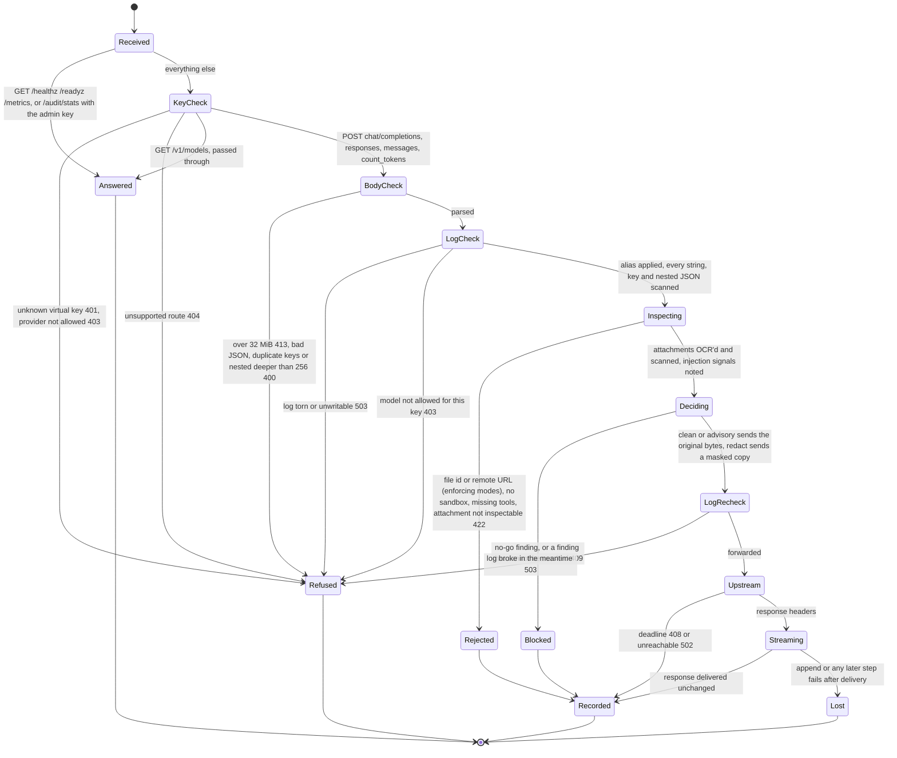

# ai-audit
Local proxy that sits in front of OpenAI and Anthropic APIs. It inspects each request (text, tool results, images, PDFs) for secrets and PII before forwarding, and writes a hash-chained audit log for every call (AI Act Art. 12-style). TypeScript, zero runtime deps.

## Quickstart
```sh
npm install && npm run build
node dist/src/cli.js serve --mode redact --log audit.jsonl        # http://127.0.0.1:8787  (npm link → `ai-audit`)
node dist/src/cli.js verify --log audit.jsonl
```
Clients: `ANTHROPIC_BASE_URL=http://127.0.0.1:8787 claude` · `OPENAI_BASE_URL=http://127.0.0.1:8787/v1 codex` (works the same for the OpenAI/Anthropic SDKs and curl). Optional headers: `x-audit-system-id`, `x-audit-use-case`.

| mode | finding → |
|---|---|
| `redact` (default) | replaced with `[REDACTED:rule]`; images blacked out; PDFs rebuilt as page images with findings blacked out (logged as `decision.rasterized`), `--no-page-redaction` or config `"pageRedaction": false` → 409 instead ([ADR 0013](docs/adr/0013-rasterize-pdfs-by-default.md)) |
| `no-go` | 409, upstream never called, response lists rule IDs only |
| `advisory` | original forwarded, finding logged |

Uninspectable attachment (corrupt, unsupported, remote URL, file id) → 422. A rebuilt PDF or image is inspected again; if a finding survives or a box cannot be mapped → 409. A rasterized PDF reaches the model as page images only (no text layer, more tokens, OCR-quality answers). Detects: Gitleaks key shapes (AWS, GitHub `ghp_`/`github_pat_`/`ghu_`/`ghs_`/`gho_`/`ghr_`, OpenAI, Anthropic, GCP, Stripe, Slack, Azure AD client secrets, JWT incl. wrapped, private keys), OpenRouter and xAI keys, e-mail, phone, PESEL, IBAN (checksum and country length); also catches keys followed by punctuation, secrets split across text parts, OCR text, PDF text and metadata. Contextual rules cover AWS secret-access keys (also as an unlabeled `KEY_ID : SECRET` pair or percent-encoded in a URL) and session tokens, presigned S3/GCS URL tokens and signatures, database URLs and Go `user:pass@tcp(...)` DSNs containing credentials (the whole URL or DSN is masked), `PGPASSWORD`/`MYSQL_PWD`/`db_password` (also with prefixes such as `PROD_DB_PASSWORD`), OAuth client secrets/refresh tokens (also `AZURE_CLIENT_SECRET`), and structured credential fields including GCP service-account `private_key`. Credentials without a shape are found by their name: a value assigned to, or a JSON field named, `*password`, `*secret`, `*token`, `*private_key`, `*api_key` or `*access_key`, skipping code references, types and pagination tokens ([ADR 0028](docs/adr/0028-named-credentials.md)). JSON inside tool arguments/results is inspected recursively; nested duplicate keys cannot be safely rewritten and block enforcing modes.
Prompt-injection signal: a few deterministic rules flag suspicious instructions in tool results and attachment text. It is logged only (rule + path), never blocks, and is easy to bypass ([ADR 0010](docs/adr/0010-advisory-prompt-injection-signal.md)).

## Request flow
One request through the proxy, in the order `src/proxy.ts` handles it:



`Recorded` appends exactly one hash-chained `llm-call` record (ADR 0009); `count_tokens` is inspected the same way but skips both log checks and is never logged. `Refused` writes no record and forwards nothing. `Lost` is the residual window from ADR 0016: the client already has the response, so the failure is counted in `ai_audit_log_write_failures_total` and reported on stderr as `audit_log_write_failed`, whose reason is an error code (`ENOSPC`) or class (`TypeError`), never the message. The append lock and anchors are drawn in [docs/verification](docs/verification/README.md).

## Development
`npm run build` compiles with TypeScript (`tsc`); tests, demos and benchmarks use that output. `npm run build:fast` uses the pinned experimental [tsrs](https://github.com/oxc-project/tsrs) Rust compiler instead. It is about 15x faster, for local iteration. It needs `--skipLibCheck` because tsrs reports TS5115 for circular types in Zod dependency declarations.

Fuzzing comes in two kinds. The seeded generators in `test/fuzz.test.ts` run in `npm test`. `npm run fuzz` runs them 50 times longer; set `FUZZ_SCALE` and `FUZZ_SEED` to change it. `npm run fuzz:coverage` runs the coverage-guided [Jazzer.js](https://github.com/CodeIntelligenceTesting/jazzer.js) targets in `fuzz/` for `FUZZ_SECONDS` each (default 300). Jazzer.js has native code, so it lives in its own package in `fuzz/` and stays out of the main install. It can't see inside regular expressions, so slow-regex inputs are caught by timing a repeated pattern instead. Each finding is saved in `fuzz/artifacts/` and should become a "found by fuzzing" test.

CI ([ADR 0030](docs/adr/0030-ci-and-pinned-bend-archive.md)) runs `npm test` on Linux with Node 22, 24 and 26, with the attachment tools and bwrap installed, so no test skips there. It also runs `npm run verify:bend` and `spec/run.sh` on every push to `main` and every pull request. Each night it runs `npm run fuzz` and 600 s of Jazzer.js per target, and keeps the corpus. `sh bend/install.sh` installs the pinned Bend 2.0.38 and checks the archive's sha256.

## Log tools
`ai-audit verify [--anchors a.jsonl]` checks the chain (with anchors it also catches a swapped or truncated file) · `ai-audit anchor --anchors a.jsonl` (run daily, keep the anchors file somewhere else) · `ai-audit report --from 2026-10-01 --to 2026-11-01` · `ai-audit decide|approve|replay` for decision records (see below).
Gateway: `ai-audit keygen --name agent` creates a virtual key (only its hash goes in `--config`, together with allowed `models`/`providers`). Response content: by default the log keeps only `outputHash` and tool-call `argsHash`; a key with `"logContent": true` (agents/services, `keygen --log-content`) also keeps the redacted output and tool args, e.g. `{"keys":[{"name":"quote-agent","sha256":"…","models":["*"],"logContent":true}]}`. Each line records `content: "hash"|"redacted"` ([ADR 0011](docs/adr/0011-response-content-per-key.md)). Real keys live in `AI_AUDIT_UPSTREAM_OPENAI_KEY` / `_ANTHROPIC_KEY`, which are only set in the proxy's environment. Config `aliases` (`{"fast":{"model":"gpt-4o-mini","upstream":"…"}}`) switch model or upstream without changing the client. `ai-audit stats --by key|model|hour`, or `GET /audit/stats?by=…` with `x-admin-key` (`AI_AUDIT_ADMIN_KEY`), shows tokens, cached tokens, latency and errors. A call whose provider reported no usage counts in `unknownUsage` (per field: `unknownInputUsage`/`unknownOutputUsage`), never as 0, and `tokensComplete: false` marks totals as a lower bound ([ADR 0012](docs/adr/0012-unknown-usage-never-zero.md)). OpenAI chat streams omit usage unless the client sends `"stream_options": {"include_usage": true}`; the proxy never adds it (ADR 0009), so set it in your clients. Also `/healthz`, `/readyz` and `/metrics`.

Context composition: each `llm-call` record has `context.bytes` per segment (`system`, `tools`, `user`, `assistant`, `toolResults`, `attachments`, `other`). When the provider reported prompt tokens, `context.tokens` splits that total across the segments by size (`tokenBasis: "provider-scaled"`). Otherwise it stays `"unknown"`. Sizes only, never content ([ADR 0017](docs/adr/0017-context-composition-metadata.md)).

Sessions: each record has `session: {id, turn, digest, parent, messages}`. A request whose message list starts with an earlier request's full list is that conversation's next turn. Edited history branches from the last shared turn. Digests are HMACs under a proxy-local key in `<log>.session-key` (mode 0600). No content or headers are used ([ADR 0018](docs/adr/0018-keyed-session-linking.md)).

Context map: `ai-audit context` lists sessions. `ai-audit context --session <id> --output session.html` writes a self-contained HTML page with two charts:
- a token timeline with provider-reported cache read, cache write, uncached input and output per request. Cache busts are marked, with the signal: P is a prefix rewrite, C is a provider cache drop.
- an arena map: one row per request, blocks in prompt order, coloured by how many turns they stayed unchanged at their position. A red marker shows the first changed offset, where every cached token behind it is lost.

The header shows peak tokens, cache hit rate, busts and the share of the preamble (tools and system). Sizes and keyed hashes only ([ADR 0020](docs/adr/0020-context-arena-and-cache-busts.md)). The image below is from a real gpt-4o-mini session sent through the proxy on 2026-10-21 by `examples/context-map/live.mjs` (11 requests, about 107k prompt tokens, under 0.01 USD). The agent reads ai-audit's own files with tools. At t5 a skill tool is inserted near the front of the tool list, then come a retry and an edited branch. In that run OpenAI reported 0 cached tokens at t5, so both signals fired. Every other request after t1 reused the previous prefix. To run it, start `ai-audit serve` with `AI_AUDIT_UPSTREAM_OPENAI_KEY` and `AI_AUDIT_CLIENT_KEY`, then run `AI_AUDIT_URL=http://127.0.0.1:8787 AI_AUDIT_CLIENT_KEY=... node examples/context-map/live.mjs`. `examples/context-map/generate.mjs` builds a similar page offline from fake data.


Metrics: `GET /metrics` returns OpenMetrics text (Prometheus and VictoriaMetrics scrape it): `ai_audit_requests_total{route,decision,status}`, `ai_audit_request_duration_seconds` (histogram, 5 ms to 300 s), `ai_audit_log_unavailable_total`, `ai_audit_log_write_failures_total`, `ai_audit_injection_signals_total{rule}`, `ai_audit_quineling_events_total{where,op}`, `ai_audit_upstream_responses_total{provider,class}`, `ai_audit_upstream_errors_total{provider,reason}`, `ai_audit_unknown_usage_total{provider,field}`, `ai_audit_attachments_inspected_total`, `ai_audit_sandbox_unavailable_total`, `ai_audit_sandbox_disabled` and attachment cache hits/misses. Labels come from fixed sets (unknown paths are `route="other"`), never from content. The endpoint has no auth, like `/healthz`: it exposes counts only. The proxy binds to 127.0.0.1 by default; if you expose it, restrict `/metrics` at the network layer. A ready-made stack (VictoriaMetrics, Grafana dashboard and alerts, ntfy) is in [examples/monitoring](examples/monitoring/README.md).

Every logged inspection decision (including blocks and attachment failures) carries `inspectionProfile`: `scannerVersion`, `rulesDigest`, `configDigest`, and a combined `digest`. The same immutable policy snapshot keys the attachment cache and sanitizes logged output. `ai-audit profile [--mode MODE] [--no-page-redaction] [--config FILE] [--allow-hashes FILE]` prints the current request profile for comparison. An allowlist file is a JSON array of exact secret SHA-256 hashes; entries are never logged. Older records remain valid without profiles; their policy cannot be reconstructed retroactively. See [ADR 0014](docs/adr/0014-versioned-inspection-profiles.md).

## Scrub retained histories
Export an inactive conversation history from your agent or support system, then write a separate sanitized copy:
```sh
ai-audit scrub --input history.jsonl --output history.redacted.jsonl
ai-audit scrub --input conversation.json --output conversation.redacted.json > scrub-receipt.json
```
The scanner covers prompts, assistant output, tool arguments/results, titles and other JSON text. JSON strings containing structured credential files are scanned too. `.json` inputs use one JSON document; other extensions default to JSONL (`--format json|jsonl` overrides). JSONL streams one record at a time, with a default 32 MiB byte limit per record (`--max-record-bytes N`); a JSON document has that same total limit. `--allow-hashes FILE` uses the same exact-value exemptions as the proxy.

Originals are opened read-only. The command re-inspects sanitized text, rejects detected source changes, and publishes a complete file with mode `0600` without overwriting existing paths. Malformed JSON/UTF-8, duplicate keys, secrets in object keys and chained audit records fail without publishing partial output. Receipts on stdout contain profile identity, record/change counts, per-rule counts and the sanitized output digest; errors contain static codes. Audit logs and external anchors remain intact. Database URL detection covers userinfo passwords and `password`/`passwd`/`pwd` query parameters, including percent-encoded parameter names.

This command is text-only: data URIs and Anthropic base64 payloads remain unchanged and **attachments are excluded**, as the receipt states. Metadata can be sanitized. It cleans the export; import it through your application's supported workflow to replace retained history there. It does not remove earlier copies from that application, backups or model providers. See [ADR 0015](docs/adr/0015-offline-history-scrubbing.md).

## Deploy (Docker)
`docker build -t ai-audit .` (default `BASE=node:26.12.1-slim`; `--build-arg BASE=platformatic/node-caged:26.12.1-slim` for V8 pointer compression) · `docker run -p 8787:8787 -v $PWD/data:/data ai-audit`. bwrap inside Docker needs `--cap-add SYS_ADMIN --security-opt seccomp=unconfined --security-opt apparmor=unconfined --security-opt systempaths=unconfined`, otherwise attachments fail closed (422 `audit_sandbox_unavailable`).
Pointer compression, measured (`node bench/memory.mjs`, 5 runs each): JS heap −35% (6.3 vs 9.7 MB) but RSS unchanged (~180 MB both) and throughput −8%. The proxy holds almost no objects, so we keep the official image as default. Details: [ADR 0005](docs/adr/0005-official-node-image.md). Design decisions: [docs/adr](docs/adr/).

Proxy overhead, measured (`npm run bench:overhead`, loopback mock, Node 22, 3 runs): **+0.6–0.7 ms p50, ~+1.1 ms p95** per request at concurrency 1 (redaction included); at concurrency 16 one process caps at ~2000 req/s. Details: [docs/performance/2026-10-20](docs/performance/2026-10-20/README.md).

## Check what the LLM read
The proxy returns the model's answer unchanged, so a misread or invented value reaches your code. Ask the model to return each value it reads from a text together with a quote copied from that text, then check both against the text you sent ([ADR 0031](docs/adr/0031-check-llm-answers-by-quotes.md)):
```sh
ai-audit check-quotes --source email.txt --answer answer.json
```
`email.txt`:
```
Hello, please send an offer for 10 pieces of product A-200, premium version, delivery by 15 Nov.
Jan Nowak, jan@firma.pl, +48 600 100 200
```
`answer.json`, from a model that saw the e-mail address masked by the proxy:
```json
{
  "quantity": { "value": 1, "quote": "10 pieces" },
  "product": { "value": "A-200", "quote": "product A-200" },
  "version": { "value": "premium", "quote": "premium version" },
  "contact": { "value": "Jan Nowak", "quote": "Jan Nowak, [REDACTED:pii-email]" },
  "material": { "value": "steel", "quote": null }
}
```
It prints this and exits 1 (0 when there are no issues, 2 for bad arguments or files):
```
{"ok":false,"checked":5,"issues":[{"field":"quantity","code":"value-not-in-quote"},{"field":"material","code":"quote-missing"}]}
```
- `quote-missing`: no quote, or a quote made only of masks. Ask the model for `"quote": null` when the text does not state a value, so every assumption is an issue.
- `quote-not-in-source`: the quote is not in the text.
- `value-not-in-quote`: a number or text value is not in its quote.

Case, spacing and Unicode forms are ignored, and `[REDACTED:rule]` in a quote stands for the masked text. A number is found as an integer, a decimal (`2,5`) or a grouped number (`10 000`). The output holds field names and codes only, so you can store it: pass the number of issues to your policy and send any issue to review. The command writes nothing to the log. In JavaScript, call `checkQuotes(source, answer)` from `dist/src/quotes.js`.

Not caught: a wrong value with a real quote of another passage. Issues although the value is right: numbers written as words, reformatted dates and translated values. Parts of a decimal count as found (10 is found in "10,5").

## Decision records (optional)
`ai-audit decide|approve|replay|policies` record a decision made by a fixed policy, linked to the LLM call it used: the LLM proposes, the policy decides, a person approves, and `replay` recomputes the result from the log alone. Policies are small typed programs run by the optional, vendored [Quinelings](https://github.com/CharlesHoskinson/quinelings) SDK (Node ≥ 22); the proxy runs without it. Guide, examples and limits: [docs/decisions.md](docs/decisions.md).

## Limits
- Attachments need tesseract, poppler, python3-PIL, prlimit (util-linux, so Linux only) and a working bwrap. Workers run in bwrap with no network, all capabilities dropped and an empty environment. Resource limits are preflight's: worker RLIMIT_DATA 4 GiB, CPU 90 s, files 64 MiB, 128 open files; each native tool also gets RLIMIT_AS 1.5 GiB; 120 s wall clock; 16 MiB output caps for the worker and each tool. Exceeding any of them gives 422. Read-only mounts are limited to `/usr`, the Node install and the worker script, so a worker cannot read the log, the session key, the config or your home directory. Without a usable sandbox, attachments get 422 `audit_sandbox_unavailable` and `/readyz` is 503. `--unsafe-no-sandbox` (development only) runs workers unsandboxed and records `decision.sandbox: "disabled"` ([ADR 0021](docs/adr/0021-attachment-sandbox-hardening.md)).
- Cache is in memory only. No OpenAI↔Anthropic translation. No person-name detection.
- Only PNG/JPEG/WebP/GIF images and PDF files are inspected.
- Requests rejected with 401/403 are not written to the audit log.
- AI Act mapping in DESIGN.md is unverified and not legal advice.

## License
MIT. Detection rules adapted from Gitleaks; see THIRD_PARTY_NOTICES.md.
