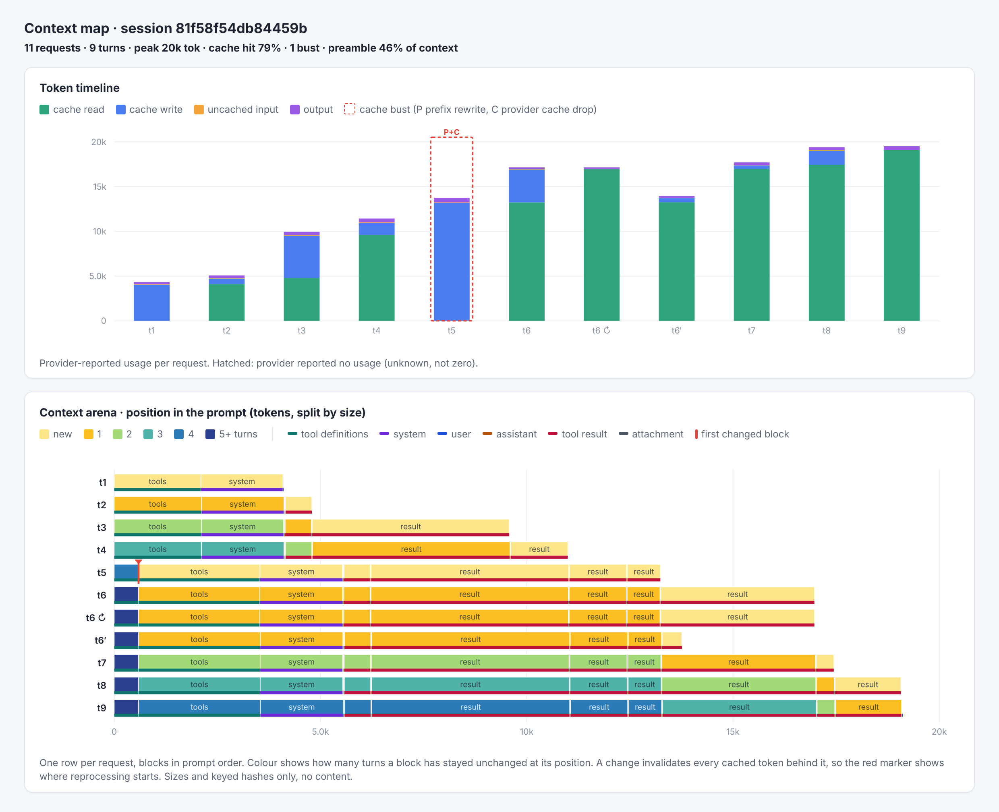
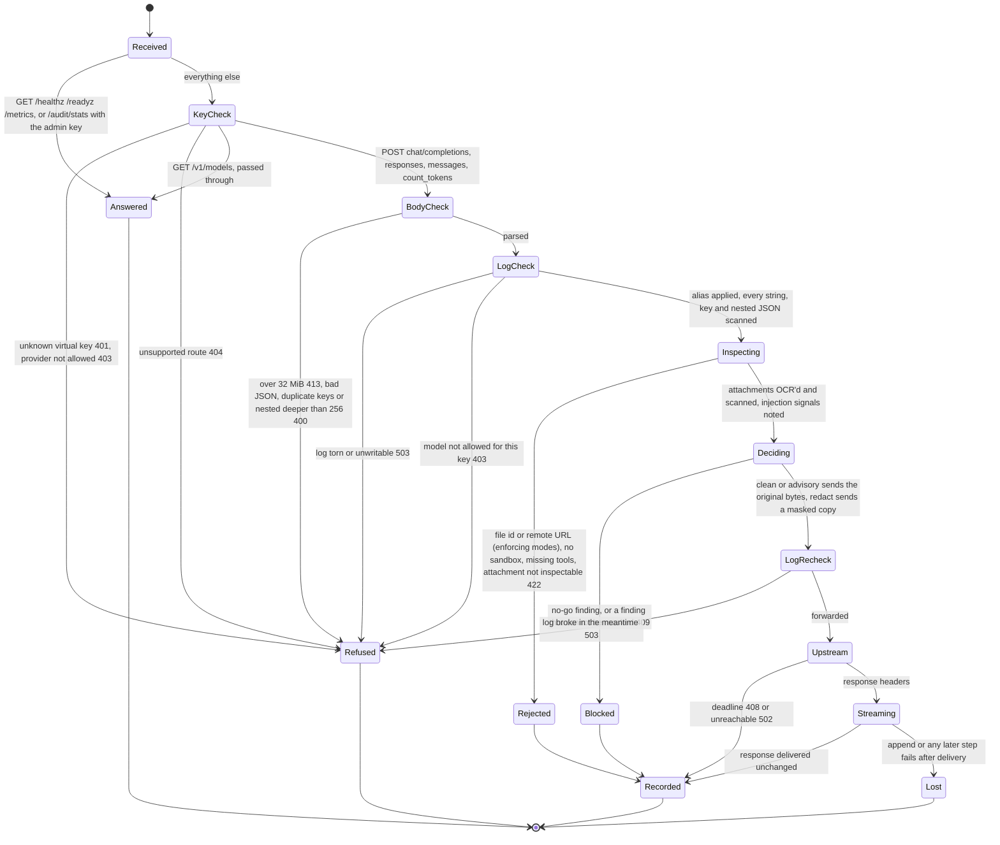

# ai-audit

For a browser-driven integration test with your own OpenAI API key, run `npm run example:workflow:real` and follow the [workflow cockpit guide](examples/workflow/README.md). The same guide shows how to point UniiChat at the running proxy. Use `npm run example:workflow` for deterministic mock-provider scenarios.

<div align="center">
<pre>
client  --->  ai-audit  --->  api.openai.com
                 |            api.anthropic.com
                 |  scan, redact or refuse
                 v
            audit.jsonl
         hash chain + anchor
</pre>
</div>

<div align="center">

[](https://github.com/adagora/ai-audit/actions/workflows/ci.yml)
[](https://github.com/adagora/ai-audit/blob/main/LICENSE)
[](https://github.com/adagora/ai-audit/blob/main/package.json)

</div>

Local proxy for the OpenAI and Anthropic HTTP APIs. It scans each request for secrets and personal data, masks or refuses the call, and appends a hash-chained audit record.

<div align="center">

```bash
git clone https://github.com/adagora/ai-audit.git && cd ai-audit && npm ci && npm run build && node dist/src/cli.js serve --mode redact --log audit.jsonl
```

</div>

There is no install script. This repository is not published on npm. `npm install -g ai-audit` installs a different program.

## TL;DR

**The problem.** Agents and SDKs send prompts, tool results, screenshots and PDFs straight to the provider. A key or an IBAN in that payload is already gone. The record you can show later is whatever the provider kept.

**The solution.** Point the client at `http://127.0.0.1:8787`. ai-audit scans the body, applies one of three modes, forwards only what that mode allows, and writes one `llm-call` line to a JSONL file. `ai-audit verify` recomputes the hash chain. `ai-audit anchor` writes a digest you store apart from the log, so a swapped or shortened file shows up.

### Why use ai-audit?

| Behavior | What you get |
|---|---|
| `redact` | Text becomes `[REDACTED:rule]`. A hit in an image is blacked out. A hit in a PDF is rebuilt as page images. |
| `no-go` | HTTP 409. The provider is never called. The response lists rule ids. |
| `advisory` | The original body goes upstream. The finding is still in the log. |
| Fail closed | A torn log, a full disk, or an attachment the proxy cannot read stops the call. |
| Virtual keys | The client holds an `aia-` key. The provider key stays in the proxy process. |
| Your log | JSONL on disk. One record per inspected call. A daily anchor file kept somewhere else. |
| Overhead | About 0.6 to 0.7 ms p50 and about 1.1 ms p95 on a loopback mock, redaction included. See [the 2026-10-20 run](docs/performance/2026-10-20/README.md). |

TypeScript, Node's standard library, no runtime dependencies. [Quinelings](https://github.com/CharlesHoskinson/quinelings) is optional and is not on the request path. Decisions are in [docs/adr](docs/adr/).

## Quick example

For one local Codex session, run `npm run codex:proxy` from the repo root. It builds the proxy, asks for your OpenAI API key if `AI_AUDIT_UPSTREAM_OPENAI_KEY` is unset, generates a temporary `aia-` client key, starts the proxy on `127.0.0.1:8788`, and launches Codex through it. The provider key stays out of Codex's environment; the proxy stops when Codex exits. The audit log and proxy diagnostics stay in ignored `live/`. Set `AI_AUDIT_PORT=8787` if you have stopped the existing demo proxy and want the native Grafana scrape to follow this session. This launcher starts the proxy and Codex, not Grafana.

```bash
git clone https://github.com/adagora/ai-audit.git
cd ai-audit
npm ci && npm run build

keygen_out=$(node dist/src/cli.js keygen --name agent)
client_key=$(printf '%s\n' "$keygen_out" | sed -n 's/^key (give to the client, not stored): //p')
config_entry=$(printf '%s\n' "$keygen_out" | sed -n 's/^config entry: //p')
printf '%s\n' "{\"keys\":[$config_entry]}" > gateway.json
printf 'export AI_AUDIT_CLIENT_KEY=%s\n' "$client_key"

export AI_AUDIT_UPSTREAM_OPENAI_KEY="sk-your-provider-key"
node dist/src/cli.js serve --mode redact --log audit.jsonl --config gateway.json
```

`serve` stays in the foreground. In a second shell, paste the `export` line the first shell printed, then:

```bash
curl -sS http://127.0.0.1:8787/healthz
curl -sS http://127.0.0.1:8787/v1/chat/completions \
  -H "authorization: Bearer $AI_AUDIT_CLIENT_KEY" \
  -H "content-type: application/json" \
  -d '{"model":"gpt-4o-mini","messages":[{"role":"user","content":"mail ada@example.com"}]}'

node dist/src/cli.js verify --log audit.jsonl
node dist/src/cli.js stats --by model --log audit.jsonl
node dist/src/cli.js anchor --log audit.jsonl --anchors anchors.jsonl
```

With virtual keys configured, the provider sees `[REDACTED:pii-email]` in place of `ada@example.com`. The client still receives the model's answer. The response carries `x-request-id`, which is the id of the `llm-call` row, and `x-audit-finding-count`.

Claude Code and the Anthropic SDK:

```bash
ANTHROPIC_BASE_URL=http://127.0.0.1:8787 claude
```

The OpenAI SDK can use `OPENAI_BASE_URL`. For Codex CLI, the shortest supported URL override is `codex -c 'openai_base_url="http://127.0.0.1:8787/v1"'`. That uses Codex's existing OpenAI credential. It works with the proxy's credential-pass-through mode, where no virtual key is configured and the client holds the provider credential. With the recommended `aia-` virtual key, select an explicit custom Responses provider so Codex sends that key to the proxy:

```bash
export AI_AUDIT_CODEX_KEY="$AI_AUDIT_CLIENT_KEY"
codex -m gpt-6-sol \
  -c 'model_provider="ai_audit"' \
  -c 'model_providers.ai_audit.name="ai-audit"' \
  -c 'model_providers.ai_audit.base_url="http://127.0.0.1:8787/v1"' \
  -c 'model_providers.ai_audit.env_key="AI_AUDIT_CODEX_KEY"' \
  -c 'model_providers.ai_audit.wire_api="responses"' \
  -c 'model_providers.ai_audit.requires_openai_auth=false' \
  -c 'model_providers.ai_audit.supports_websockets=false'
```

The OpenAI API key remains in the proxy process as `AI_AUDIT_UPSTREAM_OPENAI_KEY`. Codex sends only the `aia-` virtual key. The proxy supports `/v1/responses`; `gpt-6-sol` must be available to your API key. These flags apply to this Codex invocation and do not change your normal Codex configuration. [Codex provider settings](https://learn.chatgpt.com/docs/config-file/config-reference).

Optional request headers `x-audit-system-id` and `x-audit-use-case` are copied onto the log record as labels.

## Design

**Scan the whole request, then decide once.** Text, tool arguments, tool results, nested JSON, images and PDFs are inspected before anything is forwarded. The decision is `forward-original`, `forward-redacted`, or `block`. [ADR 0009](docs/adr/0009-inspect-whole-request.md).

**Stop when the evidence cannot be kept.** If the log is torn or cannot be appended, the proxy returns 503 and stops before the upstream call. `count_tokens` is scanned and never logged. [ADR 0016](docs/adr/0016-fail-closed-when-log-unavailable.md).

**The log stores a rule id and a JSON path.** Response bodies are stored as `outputHash` unless that virtual key opted into redacted text. [ADR 0007](docs/adr/0007-log-stores-no-values.md), [ADR 0011](docs/adr/0011-response-content-per-key.md).

**Provider keys stay in the proxy environment.** `keygen` prints an `aia-` key. Config stores its SHA-256. The upstream call uses `AI_AUDIT_UPSTREAM_OPENAI_KEY` or `AI_AUDIT_UPSTREAM_ANTHROPIC_KEY`. [ADR 0008](docs/adr/0008-virtual-keys.md).

**A decision is a later record.** `ai-audit decide` links a policy result to `x-request-id`. Replay reads the log. The proxy still serves when the Quinelings package is absent. [ADR 0004](docs/adr/0004-quinelings-optional.md).

## How it compares

| | ai-audit | Call the provider directly | LiteLLM proxy | gitleaks on the repo |
|---|---|---|---|---|
| Runs on the live API call | yes | the call is the API | yes | no, it scans files |
| Masks or blocks a secret in the prompt | yes, before forward | no | only with a guardrail you add | no |
| Hash-chained JSONL plus an anchor file you keep | yes | no | no | no |
| Image and PDF inspection in a sandbox | yes, Linux | no | no | no |
| Virtual keys, provider key stays on the proxy | yes | no | yes | no |
| One OpenAI-shaped API for many providers | no | no | yes | no |
| Setup | clone, `npm ci`, build | one environment variable | a gateway config | a CLI in CI |

Use ai-audit when Claude Code, Codex, or an official SDK must be scanned on the way out, and you want a log you can re-hash after the fact.

Use LiteLLM when the job is to send one client format to many providers. This proxy does not translate OpenAI into Anthropic. An alias may change the model or the base URL inside the same API. [ADR 0006](docs/adr/0006-aliases-same-format.md).

Use gitleaks when the secret is in a file in git. It does not see the tool result an agent is about to post.

A hosted logging gateway keeps prompts on that service. ai-audit keeps the JSONL on the machine that runs the proxy. Response text is omitted unless the virtual key set `logContent` to true, and even then the stored text is redacted.

## Installation

Node `22.23.4` or later on the 22 line, `24.22.1` or later on the 24 line, or `26.12.1` or later. CI runs the tests on Node 22, 24 and 26. There is no curl installer, no Homebrew formula, and no package on npm under this name.

### From source

```bash
git clone https://github.com/adagora/ai-audit.git
cd ai-audit
npm ci
npm run build
node dist/src/cli.js serve --mode redact --log audit.jsonl
```

`npm ci` installs the vendored Quinelings SDK from `vendor/`. The proxy starts without that package. `decide`, `replay` and `policies` then fail with `audit_qdl_unavailable`.

### On your PATH

```bash
npm run build
npm link
ai-audit serve --mode redact --log audit.jsonl
```

`npm link` points at `dist/src/cli.js`. Build first. From the repo directory, `npx ai-audit serve --mode redact --log audit.jsonl` uses the same bin.

### Docker

The image listens on `0.0.0.0:8787` and writes `/data/audit.jsonl`. The default base is `node:26.12.1-slim`.

```bash
docker build -t ai-audit .
docker run --rm -p 8787:8787 -v "$PWD/data:/data" \
  -e AI_AUDIT_UPSTREAM_OPENAI_KEY \
  -e AI_AUDIT_CLIENT_KEY \
  ai-audit
```

Extra arguments replace the image command. To change the mode, pass the full serve line:

```bash
docker run --rm -p 8787:8787 -v "$PWD/data:/data" \
  -e AI_AUDIT_UPSTREAM_OPENAI_KEY \
  ai-audit serve --host 0.0.0.0 --log /data/audit.jsonl --mode no-go
```

Attachment workers use bubblewrap. Inside Docker that needs extra privileges, or every attachment returns 422 `audit_sandbox_unavailable`:

```bash
docker run --rm -p 8787:8787 -v "$PWD/data:/data" \
  --cap-add SYS_ADMIN \
  --security-opt seccomp=unconfined \
  --security-opt apparmor=unconfined \
  --security-opt systempaths=unconfined \
  -e AI_AUDIT_UPSTREAM_OPENAI_KEY \
  ai-audit
```

Pointer-compressed builds are opt-in and slower for this process. Measured with `node bench/memory.mjs`, five runs: JS heap 6.3 MB instead of 9.7 MB, RSS still about 180 MB, throughput about 8% lower. The default image stays official Node. [ADR 0005](docs/adr/0005-official-node-image.md).

```bash
docker build --build-arg BASE=platformatic/node-caged:26.12.1-slim -t ai-audit .
```

## Quick start

1. Build, as in [From source](#from-source).
2. Create a client key and save the printed config entry.

   ```bash
   node dist/src/cli.js keygen --name agent
   ```

3. Write `gateway.json` with that `sha256`. A full file is in [Configuration](#configuration).
4. Export the provider key into the proxy's environment, not the client's.

   ```bash
   export AI_AUDIT_UPSTREAM_OPENAI_KEY="sk-your-provider-key"
   export AI_AUDIT_ADMIN_KEY="choose-a-long-admin-secret"
   ```

5. Start the proxy.

   ```bash
   node dist/src/cli.js serve --mode redact --log audit.jsonl --config gateway.json
   ```

   stderr prints one JSON line: `event` is `listening`, plus the URL, mode, log path, sandbox state and key count.
6. Point the client at the proxy and send the `aia-` key as `Authorization: Bearer` or `x-api-key`.
7. Check the chain, then store an anchor off the same disk as the log.

   ```bash
   node dist/src/cli.js verify --log audit.jsonl
   node dist/src/cli.js anchor --log audit.jsonl --anchors /elsewhere/anchors.jsonl
   ```

With an empty `keys` array and no `AI_AUDIT_CLIENT_KEY`, the proxy forwards the client's `Authorization` or `x-api-key` unchanged. The request is still scanned. The client is holding the provider key.

## Commands

After `npm link`, the binary is `ai-audit`. The examples below use that name. `node dist/src/cli.js` is the same program.

| Command | Example | Effect |
|---|---|---|
| `serve` | `ai-audit serve --mode redact --log audit.jsonl --port 8787` | Listens. Default host is `127.0.0.1`. |
| `verify` | `ai-audit verify --log audit.jsonl` | Recomputes the chain. Exit 0 when it matches, 1 when it does not. |
| `verify` | `ai-audit verify --log audit.jsonl --anchors anchors.jsonl` | Also catches a swapped or truncated file. |
| `anchor` | `ai-audit anchor --log audit.jsonl --anchors anchors.jsonl` | Appends an anchor. Run it daily. Keep the anchor file somewhere else. |
| `report` | `ai-audit report --log audit.jsonl --from 2026-10-01 --to 2026-11-01` | Markdown on stdout for that interval. |
| `stats` | `ai-audit stats --log audit.jsonl --by key` | Table of tokens, cached tokens, latency and errors. `--by` is `key`, `model` or `hour`. |
| `context` | `ai-audit context --log audit.jsonl` | Table of sessions. |
| `context` | `ai-audit context --log audit.jsonl --session ID --output session.html` | One self-contained HTML page. |
| `workbench` | `ai-audit workbench --log audit.jsonl --output workbench.html` | Private, self-contained index of sessions, context sizes, scan history, Quinelings observations and decisions from a verified log snapshot. |
| `keygen` | `ai-audit keygen --name agent` | Prints the client key and a config object. Add `--log-content` to store redacted output for that key. |
| `profile` | `ai-audit profile --mode redact --config gateway.json` | JSON identity of the current scanner, mode and config. |
| `scrub` | `ai-audit scrub --input history.jsonl --output history.redacted.jsonl` | A separate sanitized copy, plus a receipt on stdout. |
| `check-quotes` | `ai-audit check-quotes --source email.txt --answer answer.json` | Checks values the model claims to have read. |
| `decide` | `ai-audit decide --policy policy.json --inputs inputs.json --system-id shop --use-case quote` | Records a policy decision. |
| `approve` | `ai-audit approve --decision ID --reviewer ada --verdict approved` | Appends a review. Verdicts are `approved`, `overridden`, `rejected`. |
| `replay` | `ai-audit replay --decision ID --anchors anchors.jsonl` | Recomputes that decision from the log. |
| `lab` | `ai-audit lab --log audit.jsonl --session ID --baseline-limit 2 --candidate-limit 3 --output comparison.html` | Compares failure thresholds on recorded observations; never stops an agent. |
| `receipt` | `ai-audit receipt --decision ID --output receipt.html` | HTML page with downloads for a completed QDL decision. `--format svg` or `--format json` exports a portable receipt. |
| `verify-receipt` | `ai-audit verify-receipt --input receipt.svg` | Replays a portable JSON or SVG receipt without the original log. |
| `attest-keygen` | `ai-audit attest-keygen --private-key reviewer.pem --public-key reviewer.pub.pem` | Creates an Ed25519 signing key pair in new files. |
| `attest` | `ai-audit attest --log audit.jsonl --decision ID --verdict approved --private-key reviewer.pem --output decision.attestation.json` | Signs the replayable decision, latest matching review record and log checkpoint. |
| `verify-attestation` | `ai-audit verify-attestation --input decision.svg --attestation decision.attestation.json --public-key reviewer.pub.pem` | Replays the receipt and verifies the detached signature with the supplied key. |
| `policies` | `ai-audit policies --system-id shop --use-case quote` | One JSON object per policy version on that use case. |

### Share a QDL decision

```sh
ai-audit receipt --log audit.jsonl --decision ID --output receipt.html
ai-audit receipt --log audit.jsonl --decision ID --format svg --output decision.svg
ai-audit receipt --log audit.jsonl --decision ID --format json --output decision.json
ai-audit verify-receipt --input decision.svg
```

The HTML page includes SVG and JSON downloads for a completed, consistent QDL decision. The SVG shows the Quinelings body beside its calculation steps and embeds the exact program and inputs in XML metadata. You can place it in a report or send it to someone who has the compatible Quinelings SDK. The SVG, JSON and HTML output paths must be new files; they never replace the source log.

`verify-receipt` checks that the program can be recovered and that the recorded calculation runs again. For SVG, it also checks that the visible drawing matches the embedded data. It returns `origin: "not-verified"` and `humanApproval: "not-verified"`: a recipient cannot authenticate the log, its external anchor, the author or a human review from this file alone. Keep the original log and an independently stored anchor for those checks. A PNG or screenshot loses the replay metadata. [ADR 0036](docs/adr/0036-portable-qdl-decision-receipts.md).

### Sign a reviewed decision and checkpoint

```sh
ai-audit attest-keygen --private-key reviewer.pem --public-key reviewer.pub.pem
ai-audit approve --log audit.jsonl --decision ID --reviewer "Ada" --verdict approved
ai-audit receipt --log audit.jsonl --decision ID --format svg --output decision.svg
ai-audit attest --log audit.jsonl --decision ID --verdict approved --private-key reviewer.pem --output decision.attestation.json
ai-audit verify-attestation --input decision.svg --attestation decision.attestation.json --public-key reviewer.pub.pem
ai-audit workbench --log audit.jsonl --output signed-workbench.html --input decision.svg --attestation decision.attestation.json --public-key reviewer.pub.pem
```

Keep the private key outside the log and backups of the log. Give the public key to recipients through a channel they already trust. The attestation binds the portable receipt to one signed checkpoint and the latest recorded review verdict; it omits the reviewer name and note. Verification authenticates the key and signed review record, not the person's identity, the truth of the review, or a trusted timestamp. If the key is not independently trusted, the signature only proves internal consistency. The workbench checks that its verified log contains the signed checkpoint before displaying the status. [ADR 0038](docs/adr/0038-detached-signed-decision-attestations.md).

**Review before sharing.** The portable files include exact policy source, inputs and outputs. Export applies the scanner, but that is not complete anonymisation. The full HTML receipt can also contain reviewer names, notes and caller assertions. Refused, failed and incomplete decisions remain diagnostic HTML; they cannot become a portable replay receipt.

`--log` defaults to `./audit.jsonl` on every command that reads the log. `--from` defaults to `1970-01-01` and `--to` defaults to `9999-12-31`. `anchor` with no `--anchors` writes `<log>.anchors` beside the log. Keep that file somewhere else if it is supposed to catch a replaced log.

### `serve`

```bash
ai-audit serve \
  --mode redact \
  --log audit.jsonl \
  --host 127.0.0.1 \
  --port 8787 \
  --config gateway.json \
  --allow-hashes allow.json \
  --upstream-openai https://api.openai.com \
  --upstream-anthropic https://api.anthropic.com
```

`--mode` is `redact`, `no-go` or `advisory`. The default is `redact`. `--no-page-redaction` and `"pageRedaction": false` both turn PDF rasterizing off. A PDF finding then returns 409 instead of a rebuilt file. [ADR 0013](docs/adr/0013-rasterize-pdfs-by-default.md).

`--unsafe-no-sandbox`, or `AI_AUDIT_UNSAFE_NO_SANDBOX=1`, runs attachment workers with no bubblewrap. Development only. The log records `decision.sandbox` as `disabled`. [ADR 0021](docs/adr/0021-attachment-sandbox-hardening.md).

| Request | Who can call it | Result |
|---|---|---|
| `GET /healthz` | anyone | `ok` |
| `GET /readyz` | anyone | `ready`, or 503 `audit_tools_missing`, or 503 `audit_sandbox_unavailable` |
| `GET /metrics` | anyone | OpenMetrics text. Counts only. |
| `GET /audit/stats?by=model` | header `x-admin-key` | Same numbers as `ai-audit stats` |
| `GET /v1/models`, `GET /v1/models/:id` | virtual key, when keys are configured | Passed through, not scanned as a prompt |
| `POST /v1/chat/completions` | virtual key, when keys are configured | Scanned, then forwarded or refused |
| `POST /v1/responses` | same | same |
| `POST /v1/messages` | same | same |
| `POST /v1/messages/count_tokens` | same | Scanned, not written to the log |

Anything else is 404 `audit_unsupported_route`.

Bodies over 32 MiB return 413 `audit_body_too_large`. Bad JSON is 400 `audit_malformed_json`. Duplicate keys are 400 `audit_duplicate_keys`. Nesting deeper than 256 is 400 `audit_json_too_deep`. The upstream call is abandoned after 180 seconds with 408 `audit_deadline_exceeded`. An upstream that cannot be reached is 502 `audit_upstream_unreachable`. Both of those are still logged.

Error bodies look like this. On a block, `findings` holds rule ids and nothing else.

```json
{"type":"error","error":{"type":"audit_proxy_error","code":"audit_findings_blocked","message":"audit_findings_blocked","findings":["pii-email"]}}
```

| Mode | A finding becomes |
|---|---|
| `redact` | `[REDACTED:rule]` in text. Images blacked out. PDFs rebuilt as page images, logged as `decision.rasterized`. |
| `no-go` | 409 `audit_findings_blocked`. Upstream is not called. |
| `advisory` | Original bytes forwarded. Finding logged. |

A finding that cannot be masked is 409 `audit_unredactable_finding` in `redact` and `no-go`. That includes a secret in an object key, nested duplicate keys, and a box the PDF rasterizer cannot map. The rebuilt image or PDF is scanned again. A hit that survives is also 409.

A rasterized PDF reaches the model as page images. There is no text layer. The call spends more tokens, and the model is reading OCR.

Prompt injection is a few deterministic rules on tool results and attachment text. The proxy logs the rule and the path, sets `x-audit-signal-count`, and still forwards when the mode would forward. The rules are easy to bypass. [ADR 0010](docs/adr/0010-advisory-prompt-injection-signal.md).

#### What the scanner matches

Rules are adapted from Gitleaks, plus the rows below. A match followed by punctuation still counts. A secret split across text parts still counts. OCR text, PDF text and PDF metadata are scanned. JSON inside tool arguments and tool results is walked. See [THIRD_PARTY_NOTICES.md](THIRD_PARTY_NOTICES.md) and [ADR 0028](docs/adr/0028-named-credentials.md).

| Rule ids | What matches |
|---|---|
| `aws-access-token`, `aws-secret-access-key`, `aws-session-token` | AWS key id shapes, a secret next to a key id, an unlabeled `KEY_ID : SECRET` pair, a percent-encoded secret, a session token |
| `github-pat`, `github-fine-grained-pat`, `github-app-token`, `github-oauth`, `github-refresh-token` | `ghp_`, `github_pat_`, `ghu_`, `ghs_`, `gho_`, `ghr_` |
| `openai-api-key`, `anthropic-api-key`, `anthropic-admin-api-key`, `openrouter-api-key`, `xai-api-key` | Those vendors' key shapes |
| `gcp-api-key`, `stripe-access-token`, `slack-bot-token`, `slack-user-token`, `slack-webhook-url` | GCP, Stripe, Slack |
| `azure-ad-client-secret` | Azure AD client secret shape, and `AZURE_CLIENT_SECRET` by name |
| `jwt`, `private-key` | JWTs, including wrapped ones, and PEM private keys |
| `presigned-url-credential` | `X-Amz-Security-Token`, `X-Amz-Signature`, `X-Goog-Signature` |
| `database-credentials`, `database-password` | URLs and Go `user:pass@tcp(...)` DSNs with credentials. The whole URL or DSN is masked. `PGPASSWORD`, `MYSQL_PWD`, `db_password`, including prefixes such as `PROD_DB_PASSWORD`. Userinfo passwords and `password`, `passwd`, `pwd` query parameters, including percent-encoded names |
| `credential-client-secret`, `credential-refresh-token` | OAuth client secrets and refresh tokens |
| `pii-email`, `pii-phone`, `pii-pesel`, `pii-iban` | Email addresses. Phone numbers written with `+` or `00`, or as three groups of three digits. PESEL. IBAN with checksum and country length, including a Polish IBAN written without the `PL` prefix |
| `named-credential` | A value assigned to, or a JSON field named, `*password`, `*secret`, `*token`, `*private_key`, `*api_key` or `*access_key`. Code references, types and pagination tokens are skipped. A GCP service-account `private_key` is in this set |
| `ambiguous-json`, `deep-json` | Nested JSON that cannot be rewritten safely. Enforcing modes block |

`--allow-hashes` points at a JSON array of lowercase SHA-256 hex digests of exact secret values. A listed value is not a finding. The digest is not written to the log.

Every logged decision carries `inspectionProfile`: `scannerVersion`, `rulesDigest`, `configDigest`, and a combined `digest`. The same snapshot keys the attachment cache. Older rows stay valid without a profile. Their policy cannot be rebuilt later. [ADR 0014](docs/adr/0014-versioned-inspection-profiles.md).

```bash
ai-audit profile --mode redact --no-page-redaction --allow-hashes allow.json
```

#### Sessions, usage and the context map

A request whose message list starts with an earlier request's full list is the next turn of that session. An edited history branches at the last shared turn. Digests are HMACs under a key in `<log>.session-key`, mode `0600`. The HMAC input is the message list. [ADR 0018](docs/adr/0018-keyed-session-linking.md).

Each `llm-call` has `context.bytes` for `system`, `tools`, `user`, `assistant`, `toolResults`, `attachments` and `other`. When the provider reported prompt tokens, `context.tokens` splits that total by size and `tokenBasis` is `provider-scaled`. Otherwise `tokenBasis` is `unknown`. Sizes only. [ADR 0017](docs/adr/0017-context-composition-metadata.md).

A call the provider did not price is counted in `unknownUsage`, per field `unknownInputUsage` and `unknownOutputUsage`. It is never stored as zero. `tokensComplete: false` means the totals are a lower bound. [ADR 0012](docs/adr/0012-unknown-usage-never-zero.md).

OpenAI chat streams omit usage unless the client sends `"stream_options": {"include_usage": true}`. The proxy does not add that flag.

```bash
ai-audit context --log audit.jsonl
ai-audit context --log audit.jsonl --session "$SESSION_ID" --output session.html
```

`$SESSION_ID` is an `id` from the table printed by the first command. An unknown id prints `audit_unknown_session` and exits 2.

The HTML page has two charts. The timeline is provider-reported cache read, cache write, uncached input and output. A cache bust is marked `P` when the prefix was rewritten and `C` when the provider dropped the cache. The arena is one row per request, blocks in prompt order, colored by how many turns a block stayed at that position. A red marker is the first changed offset. Cached tokens after that offset are gone. The header shows peak tokens, cache hit rate, busts, and the share taken by tools and system. [ADR 0020](docs/adr/0020-context-arena-and-cache-busts.md).

The picture is a real `gpt-4o-mini` session sent through the proxy on 2026-10-21 by `examples/context-map/live.mjs`. Eleven requests, about 107k prompt tokens, under 0.01 USD. The agent reads this repo with tools. At turn 5 a skill tool is inserted near the front of the tool list, then a retry and an edited branch. OpenAI reported 0 cached tokens at that turn, so both signals fired. Later turns reused the previous prefix.



```bash
# Proxy already running, with AI_AUDIT_UPSTREAM_OPENAI_KEY and AI_AUDIT_CLIENT_KEY set.
AI_AUDIT_URL=http://127.0.0.1:8787 AI_AUDIT_CLIENT_KEY="aia-..." node examples/context-map/live.mjs
node examples/context-map/generate.mjs
```

`generate.mjs` builds a similar page from fake data and does not call a provider.

#### Evidence workbench

Use the workbench to move from a Grafana signal to individual records without adding session IDs or content to `/metrics`:

```bash
ai-audit workbench --log audit.jsonl --output workbench.html \
  --from 2026-10-27T00:00:00Z --to 2026-10-28T00:00:00Z
```

The command verifies one hash-chained snapshot before it writes a new file. The HTML starts with expandable request investigations: a metadata fact sheet and a path through inspection, forwarding, provider result, tool observations and linked QDL decisions. Each stage labels observed, derived or unknown evidence. The rest of the page shows linked sessions, context sizes, usage, scan rule paths, Quinelings operations and reviews. It has local search and links between calls and sessions. Tables and investigations show the latest 500 calls; totals count the full interval. Narrow the interval to inspect older rows. Run the command again with a new output filename after new traffic.

The workbench omits retained output text, QDL source and inputs, reviewer names and notes. It cannot recover prompt text or a detected value because the proxy never stored them. The workbench is a private investigation file, not a shareable proof of origin. For one completed QDL decision, use `receipt --format svg` or `--format json`, inspect its exact contents, then give the recipient the artifact and `verify-receipt`. [ADR 0037](docs/adr/0037-offline-evidence-workbench.md), [ADR 0042](docs/adr/0042-request-investigation-from-metadata.md).

#### Metrics

`GET /metrics` is OpenMetrics. Prometheus and VictoriaMetrics can scrape it. The bind address is `127.0.0.1` unless you change `--host`. The path has no authentication. If you expose the port, block `/metrics` in front of the proxy.

`ai_audit_requests_total{route,decision,status}`, `ai_audit_request_duration_seconds` from 5 ms to 300 s, `ai_audit_log_unavailable_total`, `ai_audit_log_write_failures_total`, `ai_audit_injection_signals_total{rule}`, `ai_audit_quineling_events_total{where,op}`, `ai_audit_upstream_responses_total{provider,class}`, `ai_audit_upstream_errors_total{provider,reason}`, `ai_audit_unknown_usage_total{provider,field}`, `ai_audit_attachments_inspected_total`, `ai_audit_sandbox_unavailable_total`, `ai_audit_session_index_rebuild_failures_total`, gauge `ai_audit_sandbox_disabled`, gauge `ai_audit_attachment_cache_hits`, gauge `ai_audit_attachment_cache_misses`.

Unknown paths are `route="other"`. Labels are taken from fixed sets. A ready-made VictoriaMetrics, Grafana and ntfy stack is in [examples/monitoring](examples/monitoring/README.md). [ADR 0019](docs/adr/0019-metrics-openmetrics.md).

On a loopback mock, Node 22, three runs, `npm run bench:overhead` measured about 0.6 to 0.7 ms p50 and about 1.1 ms p95 at concurrency 1, redaction included. At concurrency 16 one process levels off near 2000 requests per second. [docs/performance/2026-10-20](docs/performance/2026-10-20/README.md).

### `scrub`

Export a conversation that is no longer active. Write a second file. Leave the export alone.

```bash
ai-audit scrub --input history.jsonl --output history.redacted.jsonl
ai-audit scrub --input conversation.json --output conversation.redacted.json > scrub-receipt.json
```

`.json` is one JSON document. Any other extension is JSONL. `--format json` or `--format jsonl` overrides that. JSONL is read one record at a time. The default limit is 32 MiB per record, and the same limit applies to a whole JSON document. `--max-record-bytes N` changes it.

The scanner walks prompts, assistant output, tool arguments, tool results, titles and other JSON strings, including a credential file pasted into a string. The input is opened read-only. Sanitized text is scanned again. If the source changes during the run, nothing is published. The output is written with mode `0600` and is never overwritten. Malformed JSON, bad UTF-8, duplicate keys, a secret in an object key, or a chained audit record fails with a static code and no partial file.

The receipt on stdout has the profile id, record and change counts, per-rule counts, and the digest of the sanitized file.

Scrub does not read data URIs or Anthropic base64 image payloads, and it does not open attachments. The receipt says so. It also does not delete the copy still sitting at the provider, in backups, or in the application you exported from. Import the sanitized file through that application's own path. [ADR 0015](docs/adr/0015-offline-history-scrubbing.md).

### `check-quotes`

The proxy returns the model's answer unchanged, so a misread number still reaches your code. Ask the model for each value together with a quote copied from the text it saw, then check both.

```bash
ai-audit check-quotes --source email.txt --answer answer.json
```

`email.txt`, the text the model actually saw:

```
Hello, please send an offer for 10 pieces of product A-200, premium version, delivery by 15 Nov.
Jan Nowak, jan@firma.pl, +48 600 100 200
```

`answer.json`, after the proxy had already masked the email:

```json
{
  "quantity": { "value": 1, "quote": "10 pieces" },
  "product": { "value": "A-200", "quote": "product A-200" },
  "version": { "value": "premium", "quote": "premium version" },
  "contact": { "value": "Jan Nowak", "quote": "Jan Nowak, [REDACTED:pii-email]" },
  "material": { "value": "steel", "quote": null }
}
```

The command prints the object below and exits 1. Exit 0 means no issues. Exit 2 means a bad argument or an unreadable file. Nothing is written to the audit log.

```json
{"ok":false,"checked":5,"issues":[{"field":"quantity","code":"value-not-in-quote"},{"field":"material","code":"quote-missing"}]}
```

| Code | Meaning |
|---|---|
| `quote-missing` | No quote, or a quote made only of masks. Ask the model for `"quote": null` when the text does not state the value. |
| `quote-not-in-source` | That quote is not in the file. |
| `value-not-in-quote` | The number or the text is not inside its own quote. |

Case, spacing and Unicode forms are ignored. `[REDACTED:rule]` in a quote stands for whatever was masked. A number matches an integer, a decimal such as `2,5`, or a grouped number such as `10 000`.

Pass `--source` the text the model saw, masks included. A wrong value with a genuine quote of some other sentence is not caught. A right value written as a word, a reformatted date, or a translation is reported. A piece of a decimal counts as found, so `10` is found inside `10,5`.

From JavaScript, after `npm run build`:

```js
import { checkQuotes } from "./dist/src/quotes.js";
console.log(checkQuotes(source, answer));
```

[ADR 0031](docs/adr/0031-check-llm-answers-by-quotes.md).

### `decide`, `approve`, `replay`

The model proposes. A fixed policy decides. A person approves. `replay` runs the decision again from the log.

```bash
ai-audit decide \
  --policy examples/quineling-quote/policy.json \
  --inputs examples/quineling-quote/inputs.json \
  --system-id shop \
  --use-case quote \
  --llm-call "$REQUEST_ID" \
  --log audit.jsonl

ai-audit approve --decision "$DECISION_ID" --reviewer ada --verdict approved --note "within the floor"
ai-audit replay --decision "$DECISION_ID" --anchors anchors.jsonl
ai-audit receipt --decision "$DECISION_ID" --output receipt.html
ai-audit policies --system-id shop --use-case quote
```

`--llm-call` must already be an `llm-call` id in the same log. The response header can arrive before that row is appended, and `decide` in that window returns `audit_unknown_llm_call`.

A policy file is either a QDL intent, `"format": "qdl-intent"`, or `{"source": "<program source>"}`. Inputs are a JSON object. Both are scanned before compile. Any finding refuses the decision and does not store the value.

`replay` exits 0 when the output matches and 1 when it does not. A refusal stored without its inputs cannot be rebuilt. That code is `audit_qdl_not_replayable`. `node:vm` replay of a plain JavaScript step is not a sandbox. Run only code you trust there.

`npm run example:lab` loads a fake session through the proxy and a mock provider, then compares two policies on it. The walkthrough, including what Quinelings will and will not do, is [docs/decisions.md](docs/decisions.md).

## Configuration

`gateway.json` is JSON. Comments in the file make `JSON.parse` fail. This is a working file:

```json
{
  "pageRedaction": true,
  "adminKeySha256": "paste-sha256-only-if-you-are-not-using-AI_AUDIT_ADMIN_KEY",
  "keys": [
    {
      "name": "agent",
      "sha256": "paste-the-sha256-keygen-printed",
      "models": ["*"],
      "providers": ["openai", "anthropic"],
      "logContent": false
    }
  ],
  "aliases": {
    "fast": { "model": "gpt-4o-mini" }
  }
}
```

| Field | Meaning |
|---|---|
| `keys[].name` | Label stored on each record. Not a secret. |
| `keys[].sha256` | SHA-256 of the client key, as printed by `keygen`. |
| `keys[].models` | Model ids this key may request. `"*"` allows any. The check uses the name the client sent and the name after an alias. |
| `keys[].providers` | `openai`, `anthropic`, or both. Omit the field to allow both. |
| `keys[].logContent` | `true` stores redacted output text and redacted tool arguments. Default is hashes only. |
| `aliases` | Map from the client's model string to `{ "model", "upstream" }`. `upstream` is optional. The API format stays the same. |
| `pageRedaction` | `false` disables PDF rasterizing. Default is on. `--no-page-redaction` also disables it. |
| `adminKeySha256` | SHA-256 of the admin key. Ignored when `AI_AUDIT_ADMIN_KEY` is set, because the proxy hashes that variable itself. |

`allow.json` is a JSON array of lowercase SHA-256 hex strings. Each string is the hash of one exact secret you have decided to let through. The file is not copied into the log.

```json
["0123456789abcdef0123456789abcdef0123456789abcdef0123456789abcdef"]
```

Replace the placeholder. Each entry is the lowercase hex SHA-256 of one exact value. The digest of an empty string, or a hash that includes a trailing newline, does not match the value in the prompt.

| Variable | Who reads it | Effect |
|---|---|---|
| `AI_AUDIT_UPSTREAM_OPENAI_KEY` | `serve` | Sent as `Authorization: Bearer` after a virtual key checks out. |
| `AI_AUDIT_UPSTREAM_ANTHROPIC_KEY` | `serve` | Sent as `x-api-key` on Anthropic routes. |
| `AI_AUDIT_CLIENT_KEY` | `serve` | Adds a virtual key named `default`, next to any keys in the config. |
| `AI_AUDIT_CLIENT_LOG_CONTENT` | `serve` | Set to `1` to turn on `logContent` for that default key. |
| `AI_AUDIT_ADMIN_KEY` | `serve` | Unlocks `GET /audit/stats`. The hash of this value wins over `adminKeySha256`. |
| `AI_AUDIT_UNSAFE_NO_SANDBOX` | `serve` | Set to `1` for the same effect as `--unsafe-no-sandbox`. |
| `AI_AUDIT_URL`, `AI_AUDIT_CLIENT_KEY` | `examples/context-map/live.mjs` | Where the example sends its session. The proxy does not read `AI_AUDIT_URL`. |

If virtual keys are on and the upstream variable for that provider is empty, the proxy strips the client's credential and calls upstream with no key.

## Architecture

```
Claude Code, Codex, SDK, curl
        |  Authorization: Bearer aia-...
        v
+--------------------------------------------------+
| serve                                            |
|  1. virtual key, model, provider                |
|  2. JSON limits, log can be appended            |
|  3. alias, then scan every string               |
|  4. attachments in bwrap: OCR, PDF, image       |
|  5. redact, block, or keep the original bytes   |
+--------------------------------------------------+
        |                         |
        | one llm-call            | HTTPS, provider key
        v                         v
  audit.jsonl              api.openai.com
  <log>.session-key        api.anthropic.com
  <log>.lock
        |
        |  ai-audit anchor, stored elsewhere
        v
  anchors.jsonl

Later, not on this path:
  decide -> approve -> replay
  scrub of an exported history
  check-quotes of one answer
```

One request, in the order `src/proxy.ts` handles it:



`Recorded` appends exactly one hash-chained `llm-call`. `Refused` writes nothing and forwards nothing. `Lost` is the window described in [ADR 0016](docs/adr/0016-fail-closed-when-log-unavailable.md). The client already has the body, so the failure is counted in `ai_audit_log_write_failures_total` and printed on stderr as `audit_log_write_failed`. The reason is an error code such as `ENOSPC`, or a class such as `TypeError`, never the message. The append lock and the anchor check are drawn in [docs/verification](docs/verification/README.md). TLA+ models live in `spec/`.

Attachment workers run under bubblewrap with no network, no capabilities, and an empty environment. Read-only mounts are `/usr`, the Node install, and the worker script. A worker cannot read the log, the session key, the config, or your home directory. Limits, from the preflight: worker `RLIMIT_DATA` 4 GiB, CPU 90 s, files 64 MiB, 128 open files. Each native tool also gets `RLIMIT_AS` 1.5 GiB. Wall clock is 120 s. Output caps are 16 MiB for the worker and for each tool. Crossing one of those is 422.

Masking, context blocks and usage totals are pure functions with proved laws. They are written in Bend 2 and shipped as generated JavaScript. [ADR 0029](docs/adr/0029-proved-pure-core-in-bend.md).

## Troubleshooting

### `npm install -g ai-audit` scans a directory

That name on the npm registry is a different tool. Clone this repository and run `node dist/src/cli.js`, or `npm link` after `npm run build`.

### 401 `audit_client_unauthorized`

Virtual keys are configured, and the bearer token is not one of them. Use the `aia-` string `keygen` printed. The config must contain the `sha256` from that same printout, not the key itself.

A 401 from the provider, after your proxy returned 200 from `/healthz`, usually means `AI_AUDIT_UPSTREAM_OPENAI_KEY` or `AI_AUDIT_UPSTREAM_ANTHROPIC_KEY` is unset. With virtual keys on, the client credential is removed and nothing is put in its place.

`GET /audit/stats` returns 401 `audit_admin_unauthorized` when `x-admin-key` does not match `AI_AUDIT_ADMIN_KEY`.

### 503 `audit_log_unavailable`, or `verify` prints `BROKEN`

The last line was torn, the disk is full, or the process cannot create `<log>.lock`. The proxy refuses new inspected calls until this is fixed. `GET /healthz` can still say `ok`. `GET /readyz` does not check the log.

```bash
ai-audit verify --log audit.jsonl
df -h .
ls -l audit.jsonl audit.jsonl.lock
```

Repair a torn last line only after you know which bytes were cut. Then verify again. If you keep anchors, check those too:

```bash
ai-audit verify --log audit.jsonl --anchors /elsewhere/anchors.jsonl
```

A failure after the client already received the response is a stderr line `audit_log_write_failed`. That request will not grow a second log row.

### 422 on a request with a file

`/readyz` tells you which prerequisite is missing.

| `/readyz` or error code | Fix |
|---|---|
| 503 `audit_tools_missing` | Install `tesseract-ocr`, `poppler-utils`, `python3-pil`, and `util-linux` for `prlimit`. |
| 503 or 422 `audit_sandbox_unavailable` | bubblewrap has to work. On Linux, `bwrap --version`. In Docker, add the flags in [Docker](#docker). macOS has no `prlimit` and no usable bwrap here. Text-only calls still work. |
| 422 `audit_unsupported_attachment` | Only PNG, JPEG, WebP, GIF and PDF are inspected. |
| 422 `audit_uninspectable_reference` | A file id or a remote URL cannot be fetched and scanned. Enforcing modes refuse the call. `advisory` allows it. |
| 422 `audit_inspection_failed` | The file is corrupt, a limit tripped, or a tool failed. The call is not forwarded. |

`--unsafe-no-sandbox` skips the sandbox check. Do not use it on a machine that receives untrusted files.

### 409 `audit_findings_blocked` or `audit_unredactable_finding`

`no-go` blocks every finding. `redact` blocks when the hit cannot be replaced in place. The `findings` array is rule ids.

To let one known value through, hash those exact bytes. Add no newline.

```bash
printf '%s' 'the-exact-secret' | node --input-type=module -e 'import {createHash} from "node:crypto"; const chunks = []; for await (const c of process.stdin) chunks.push(c); console.log(createHash("sha256").update(Buffer.concat(chunks)).digest("hex"))'
```

Put that lowercase hex string in `allow.json` and restart with `--allow-hashes allow.json`. `--mode no-go` refuses the call. `--mode advisory` logs the finding and forwards the original body.

### Token totals stay low, or `unknownUsage` climbs

OpenAI's streaming chat API omits `usage` unless the client asks for it. The proxy will not insert the flag.

```json
"stream": true,
"stream_options": { "include_usage": true }
```

Rows with `tokensComplete: false` are a lower bound. Do not add the missing calls in as zero.

### `decide` prints `audit_qdl_unavailable`

The optional package did not install. From the repo:

```bash
npm ci
node -e 'import("@quinelings/agent-sdk/v1").then(() => console.log("ok"))'
```

The proxy's `serve` command does not need this import.

## Limitations

- No person-name detection, no street addresses, no US Social Security numbers. Phone coverage is international numbers and one grouped digit pattern, not every national format.
- No translation between OpenAI and Anthropic request bodies.
- Attachment inspection needs Linux, bubblewrap, `prlimit`, Tesseract, poppler and Pillow. Without them, calls that carry a file fail closed.
- Inspected types are PNG, JPEG, WebP, GIF and PDF. Other files, file ids and remote URLs are refused in `redact` and `no-go`.
- The attachment cache is memory only. It dies with the process.
- Requests refused with 401, 403, 400, 404 or 413 are not audit records. `count_tokens` is scanned and not logged.
- `scrub` rewrites an export you already have. It does not reach the provider, backups, or data URIs.
- Prompt-injection rules never block, and they are easy to walk around.
- `check-quotes` misses a wrong value backed by a real quote of a different sentence. It flags numbers written as words, translated text, and reformatted dates.
- A rasterized PDF has no text layer. Answers that depend on the original text get worse, and the token count goes up.
- The AI Act discussion in [DESIGN.md](DESIGN.md) is unverified. It is not legal advice.
- `replay` of a trusted JavaScript step uses `node:vm`. That is not a sandbox.

## FAQ

### Why a proxy?

The secret often shows up in a tool result at request time. A pre-commit hook never sees that payload. The SDK already has a base URL, and the proxy takes that slot.

### Is the log a compliance certificate?

No. It is a hash-chained record of what this process inspected and what it forwarded. [DESIGN.md](DESIGN.md) sketches an Article 12 style mapping. Nobody has certified that mapping, and this README is not legal advice.

### Does the provider see my provider key in the prompt?

The provider key is added as the upstream credential after the scan, from the proxy environment. It is not taken from the logged body. A provider key that a user pasted into the prompt is a finding, same as any other key of that shape.

### What leaves the machine?

The forwarded request, original or redacted, goes to the upstream URL. Default is `https://api.openai.com` or `https://api.anthropic.com`. Metrics, the audit log and the session key stay local. `/metrics` publishes counters to whoever can open the port.

### Do I have to run Quinelings?

No. `serve`, `verify`, `scrub`, `check-quotes` and redaction work without it. Install it when a model writes the policy, or when the policy source has to survive a process restart inside the log. A short trusted function can be recorded with the built-in step log instead. See [docs/decisions.md](docs/decisions.md).

### Why did `verify` succeed and an anchor check fail?

`verify` alone checks that each line's hash matches the previous line. An attacker who replaces the whole file with another valid chain still passes. `--anchors` compares the chain to a digest you stored elsewhere.

### Why is `/readyz` failing while chat still works?

`/readyz` is 503 when attachment tools or bubblewrap are missing, even if every current request is plain text. Plain text does not need those tools. The first request that includes a file will get 422 until you install them, or until you set `--unsafe-no-sandbox`.

### Can I turn the proxy off for one call?

Point that client back at the provider. There is no per-request bypass header. `advisory` still logs, and it still refuses a body the parser will not accept.

## Development

`npm run build` is `tsc`. Tests, the demo and the benchmarks run against `dist/`. `npm run build:fast` uses the pinned [tsrs](https://github.com/oxc-project/tsrs) compiler and is about 15 times faster for local edits. It needs `--skipLibCheck` because tsrs reports TS5115 on circular types in Zod's declaration files. tsrs is a dev dependency.

`npm test` builds, then runs `node --test` on `dist/test/*.test.js`. The seeded generators in `test/fuzz.test.ts` are part of that run. `npm run fuzz` runs them 50 times longer. `FUZZ_SCALE` and `FUZZ_SEED` change that. `npm run fuzz:coverage` runs the [Jazzer.js](https://github.com/CodeIntelligenceTesting/jazzer.js) targets in `fuzz/` for `FUZZ_SECONDS` each. The default is 300. Jazzer.js has native code, so it lives in `fuzz/package.json` and is not part of the main install. It cannot see inside regular expressions. Slow-regex inputs are caught by timing a repeated pattern. A finding saved under `fuzz/artifacts/` should become a regression test.

CI runs `npm test` on Linux with Node 22, 24 and 26, with the attachment tools and bubblewrap installed, so those tests are not skipped. It also runs `npm run verify:bend` and `spec/run.sh` on every push to `main` and every pull request. Each night it runs `npm run fuzz` and 600 seconds of Jazzer.js per target, and it keeps the corpus. [ADR 0030](docs/adr/0030-ci-and-pinned-bend-archive.md).

```bash
sh bend/install.sh   # pinned Bend 2.0.38, sha256 checked
npm run verify:bend
npm run verify:formal
```

## About contributions

Issues and pull requests are welcome. There is no separate contributing guide. Run `npm test` before you push. Do not commit secrets, real API keys, or real audit logs. `live/` and `*.jsonl` from real traffic stay out of git. Tests use fake keys.

The license is MIT, copyright Adrian Góra.

## License

[MIT](LICENSE). Detection rules adapted from Gitleaks. See [THIRD_PARTY_NOTICES.md](THIRD_PARTY_NOTICES.md). The vendored Quinelings SDK is Apache-2.0. See [vendor/QUINELINGS-LICENSE](vendor/QUINELINGS-LICENSE).
