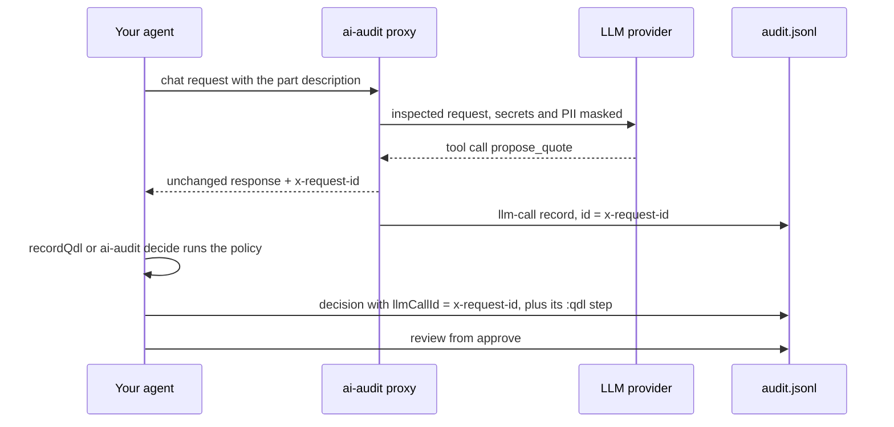

# Deterministic decisions (optional, Quinelings, Node ≥ 22)
**TL;DR: where Quinelings helps this project**
- **Proves why a decision was made, long after.** The log carries the decision program itself. `ai-audit replay` rebuilds it from the log alone and recomputes the result, and `ai-audit policies` shows which policy version decided and what changed since. The proxy proves what the AI said; the Quineling proves what was decided ([DESIGN.md](../DESIGN.md), AI Act Art. 12 and 14).
- **Compares two rules on one recorded session.** `npm run example:lab` replays two session governors over the same proxy log, shows the first decision where they disagree, and reruns a changed threshold in a fresh process ([ADR 0035](adr/0035-read-only-session-policy-comparison.md)).
- **Runs a fixed program, safely.** A program always stops, cannot read files or the network, and is refused if it invents an operation or mixes up units. The built-in `replay()` runs JavaScript in `node:vm`, which is only safe for trusted code.
- **Keeps secrets out of the evidence.** Inputs and programs are checked with the proxy's rules before anything runs; a customer e-mail or an API key stops the decision instead of landing in the log.
- **Keeps the hard cases and shows real use.** Refused and failed evaluations are recorded too, each decision links to the proxied LLM call (`llmCallId` is the proxy's `x-request-id`), and when agents run Quinelings on their own through MCP, the proxy logs which programs they compiled and ran, as hashes only.
- **Not for** the proxy's request path (one run takes ~20 ms against the proxy's ~0.6 ms), finding secrets or PII, making the LLM itself reproducible, or real actions (they are only simulated).

[Quinelings](https://github.com/CharlesHoskinson/quinelings) (`@quinelings/agent-sdk`, Apache-2.0, vendored in `vendor/`) runs small calculation programs written in QDL, a JSON format: typed inputs with units, steps from a fixed set of about 30 operations (`arithmetic`, `compareValues`, `budget`, `allocate`, `action`, …) and outputs. The SDK compiles a program into self-contained source whose hash is its identity (`ql_…`), checks types and units before anything runs, and can rebuild and rerun it anywhere from that source alone. A program is data, not JavaScript, and `action` steps are only simulated.

## The SDK on its own
Save as `qdl-hello.mjs` in the repo root and run `node qdl-hello.mjs`:
```js
import { Session } from "@quinelings/agent-sdk/v1";

const session = new Session();
const program = session.compile({
  format: "qdl-intent", version: 1, name: "Quote with a floor",
  thought: "price = max(machining minutes × shop rate, 150 PLN)",
  inputs: [
    { id: "minutes", name: "minutes", type: { kind: "number", unit: "min", min: 0 } },
    { id: "rate", name: "rate", type: { kind: "number", unit: "PLN*min^-1", min: 0 } },
    { id: "floor", value: 150, type: { kind: "number", unit: "PLN", min: 0 } },
  ],
  steps: [
    { id: "machining", op: "arithmetic", inputs: ["minutes", "rate"], params: { kind: "mul" } },
    { id: "price", op: "arithmetic", inputs: ["machining", "floor"], params: { kind: "max" } },
  ],
  outputs: ["price"],
});
const run = session.run({ artifactId: program.id, requestId: "quote-1", inputs: { minutes: 42, rate: 4.5 } });
console.log(run.result.occurrences[0].outputs);
console.log(new Session().recover({ source: program.source }).id === program.id);
```
It prints `[ 189 ]`, then `true`: a fresh session rebuilt the same program from its source. Bad programs and inputs are refused with a `QdlError` before anything runs: mixed-up units (`unit-type`), a value outside its declared range such as `minutes: -5` (`refinement`), a missing input (`missing-input`) or an operation that does not exist, for example an LLM inventing a `fetch` step (`invalid-input`). Errors at run time, such as division by zero, give a `failed` run with a diagnostic.

## Policy lab
`npm run example:lab` builds and runs a synthetic session through the proxy and a mock provider. Two governors evaluate every recorded call, including calls without usage. The demo compares thresholds, exports changed source, and reproduces the result in a fresh process. The inspection page checks that both decisions belong to the same call and inputs and that their records and replay agree. Selecting a creature region selects a calculation step.

To compare thresholds on an existing log:

```sh
node dist/src/cli.js context --log audit.jsonl
node dist/src/cli.js lab --log audit.jsonl --session SESSION_ID \
  --baseline-limit 2 --candidate-limit 3 --output comparison.html
node dist/src/cli.js lab --log audit.jsonl --session SESSION_ID \
  --baseline-limit 2 --candidate-limit 3 --format json --output comparison.json
```

The session can be omitted when the log has exactly one inferred session. Without `--output`, the command prints JSON. Output files must be new; the original log is never modified. Invalid evidence, missing sessions, invalid limits and unavailable QDL produce a content-free error on stderr and exit 2. A completed comparison exits 0 even when policies disagree.

The rule is deliberately small: pause when cumulative failed calls reach the threshold. A success does not reset the count. Retries and branches appear separately and do not count as failures themselves. Successful Responses completions and Anthropic tool handoffs are recognized. Token totals are per call, remain unknown when incomplete, and do not affect the rule. Calls appear in audit append order, which is not necessarily request-start or conversation-turn order.

The report shows every disagreement and explains the failure count and limit. After a policy first recommends pausing, later observations are labeled hypothetical under that policy. They do not prove savings or task quality. Neither the lab nor its simulated actions stop an agent.

JSON includes exact programs, inputs, outputs, runtime registry identity, snapshot-rule version and references to contributing audit records. Both programs are recovered and evaluated again in a fresh SDK session. The chain is checked from the same file snapshot; external anchors are explicitly **not checked**. Use `verify --anchors` separately when you have an independently retained anchor. Replaying the program reproduces the rule calculation; rerunning `lab` with the original log and matching snapshot rules is needed to check how the failure counts were derived. [ADR 0035](adr/0035-read-only-session-policy-comparison.md).

### Do I need Quinelings?

For ordinary proxy use, no. Redaction and request logging work without it. A simple failure threshold is also easy to implement as a normal function.

Quinelings is useful when the exact calculation must travel with its evidence, when policies change and you need to compare versions, or when a model proposes a bounded typed program that must be checked before running. Think of it as a saved recipe with its ingredients and result. It helps reproduce the recipe; it cannot establish that the ingredients were true or that the recipe was a good decision.

The quote example below exercises more of that value than a single threshold: typed units, several calculations, comparison with a model proposal and a review rule. Keep QDL optional until a workflow needs those properties.

## With ai-audit: the LLM proposes, the policy decides

The policy file the commands below use is [`examples/quineling-quote/policy.json`](../examples/quineling-quote/policy.json): price from CAM minutes, shop rate, setup and material with a 150 PLN floor; auto-approve only quotes up to 1000 PLN where the LLM's own price is within 5%, otherwise route to human review. The agent writes to the same log file as the proxy; the append lock keeps one chain ([ADR 0016](adr/0016-fail-closed-when-log-unavailable.md)).
```js
import { readFileSync } from "node:fs";
import { AuditLog } from "./dist/src/audit.js";
import { recordQdl, replayQdl } from "./dist/src/qdl.js";

const policy = JSON.parse(readFileSync("examples/quineling-quote/policy.json", "utf8"));
const res = await fetch("http://127.0.0.1:8787/v1/chat/completions", {
  method: "POST",
  headers: { "content-type": "application/json", authorization: `Bearer ${process.env.OPENAI_API_KEY}`,
    "x-audit-system-id": "cad-quote", "x-audit-use-case": "machining-quote" },
  body: JSON.stringify({
    model: "gpt-4o-mini",
    messages: [{ role: "user", content: "Quote: flange DN100, S355, CAM estimate 42 min, blank 85 PLN, setup 120 PLN." }],
    tools: [{ type: "function", function: { name: "propose_quote", parameters: { type: "object",
      properties: { minutes: { type: "number" }, material: { type: "number" }, setup: { type: "number" }, price: { type: "number" } },
      required: ["minutes", "material", "setup", "price"] } } }],
    tool_choice: { type: "function", function: { name: "propose_quote" } },
  }),
});
const llmCallId = res.headers.get("x-request-id");
const proposal = JSON.parse((await res.json()).choices[0].message.tool_calls[0].function.arguments);

const log = new AuditLog("audit.jsonl");
const { decision, step } = await recordQdl(log,
  { systemId: "cad-quote", useCase: "machining-quote", input: "flange DN100", llmCallId },
  { intent: policy },
  { minutes: proposal.minutes, rate: 4.5, setup: proposal.setup, material: proposal.material, llmPrice: proposal.price });
if (step.qdl.status !== "completed") throw new Error(`policy ${step.qdl.status}: ${step.qdl.error.code}`);
const [price, llmAgrees, autoApprove] = decision.output;
log.approve(decision.id, "A. Nowak", "approved", `LLM proposed ${proposal.price} PLN, policy says ${price} PLN`);
console.log({ llmPrice: proposal.price, price, llmAgrees, autoApprove, reproduced: (await replayQdl(log, decision.id)).reproduced });
```
The model never sees the shop rate, so its price is a guess. When it proposes 274 PLN, the script prints `{ llmPrice: 274, price: 394, llmAgrees: false, autoApprove: false, reproduced: true }`: the policy's 394 PLN (42 × 4.50 + 120 + 85) is more than 5% away from 274, so the quote goes to review and a person approves 394. On a fresh log, `node dist/src/cli.js verify --log audit.jsonl` then reports `OK: 5 records, chain intact`:

| record | written by | holds |
|---|---|---|
| `llm-call` | proxy | findings as rule + path, tool call names, output hash, usage; no prompt text |
| `decision` | `recordQdl` or `decide` | `llmCallId`, a hash of `input`, the policy outputs (only when completed) |
| `program` | `recordQdl` or `decide`, once per program | the program source; its id is the `sourceHash` |
| `decision` (id `…:qdl`) | `recordQdl` or `decide` | `status` (completed, refused or failed), the error code and path unless completed, the program's `sourceHash` (or the refused intent), its inputs, `inputHash`, `outputsHash` |
| `review` | `log.approve` or `approve` | reviewer, approved/overridden/rejected, note |

`replayQdl(log, id)` takes the decision id or its `:qdl` id, rebuilds the program from the log in a fresh session and returns `reproduced: true` when the outcome matches, refusals and failures included. Edit a logged input and `verify` reports a broken chain; replaying the edited record gives `reproduced: false`.

## Share a decision

The HTML decision receipt now offers a static SVG and replay JSON download for a completed, consistent QDL decision. The SVG uses the Quinelings frame as a visual index, with named calculation steps beside it. Its XML metadata contains exact source and inputs; the shape itself does not identify the program. The verifier rebuilds the program and checks the whole SVG presentation against those inputs.

```sh
node dist/src/cli.js receipt --log audit.jsonl --decision DECISION_ID --output receipt.html
node dist/src/cli.js receipt --log audit.jsonl --decision DECISION_ID --format svg --output decision.svg
node dist/src/cli.js verify-receipt --input decision.svg
```

The recipient can replay the calculation with the vendored compatible SDK without access to the original log. This verifies what the supplied program computes on the supplied inputs. It does not authenticate who supplied them, the log chain, external anchors or human approval. The portable package carries hashes referencing its source log so an owner can look it up, but anyone could make a different package and recompute its checksum. The viewer labels origin and approval as unverified. See [ADR 0036](adr/0036-portable-qdl-decision-receipts.md).

Review exact source, inputs and outputs before sharing. They may contain material the scanner does not recognize. The full HTML may also carry reviewer names, notes and caller assertions, so it is a different disclosure choice from the portable files. A screenshot or converted PNG keeps the picture but loses replay data.

## From the command line
Any script or agent, in any language, can do the same without JavaScript ([ADR 0023](adr/0023-decision-records-cli-and-outcomes.md)). Take `REQUEST_ID` from the `x-request-id` header of the proxied call; `--llm-call` must name an `llm-call` record already in the log. The provider's own request id (OpenAI sends one) comes back as `x-upstream-request-id`.
```sh
node dist/src/cli.js decide --log audit.jsonl --policy examples/quineling-quote/policy.json \
  --inputs examples/quineling-quote/inputs.json --system-id cad-quote --use-case machining-quote --llm-call "$REQUEST_ID"
node dist/src/cli.js approve --log audit.jsonl --decision "$DECISION" --reviewer "A. Nowak" --verdict approved --note "policy price 394 PLN"
node dist/src/cli.js replay --log audit.jsonl --decision "$DECISION"
```
Each command prints one JSON line:
```
{"decision":"1e23e101-…","status":"completed","outputs":[394,false,false,{"status":"skipped","action":"auto-approve-quote","payload":394},{"status":"simulated","action":"route-to-human-review","payload":394}]}
{"review":"a6e8fd3f-…","decision":"1e23e101-…","verdict":"approved"}
{"decision":"1e23e101-…","reproduced":true,"status":"completed","outputs":[394,false,false,…]}
```
Exit codes: `0` completed or reproduced; `1` recorded but refused or failed, or not reproduced; `2` nothing written (bad arguments, unknown id, SDK missing). A refusal is still a record: inputs with `minutes: -5` print `{"decision":"…","status":"refused","error":{"code":"refinement","path":"$.bindings.minutes"}}` and exit 1, and `replay` later reproduces the refusal. `ai-audit report` lists QDL outcomes (completed, refused, failed) next to the decision counts.

Before anything runs, the inputs, the program, `params`, `sources` and `model` are checked with the same rules and allowlist as the proxy ([ADR 0025](adr/0025-scan-decision-inputs.md)). Replay needs exact values, so nothing is masked: a finding stops the decision and only a content-free refusal is recorded. Inputs with a `customer` e-mail print `{"decision":"…","status":"refused","error":{"code":"audit-sensitive-input","path":"$.inputs.customer"},"findings":[{"rule":"pii-email","path":"$.inputs.customer"}]}` and exit 1; the log keeps the rule and the path, not the address, and `replay` exits 2 with `audit_qdl_not_replayable`. Exempt an exact value you know is safe with `--allow-hashes FILE` (a JSON array of SHA-256 hashes). Text values and keys are checked, numbers are not, and names are not detected, so this is a check, not anonymisation.

A policy computes correctly from wrong values too. Check the values the LLM read first with `ai-audit check-quotes` ([README](../README.md#check-what-the-llm-read), [ADR 0031](adr/0031-check-llm-answers-by-quotes.md)). It prints field names and codes only, so pass the number of issues as a policy input, for example `quoteIssues`, and send any issue to review.

## Policy versions
Change a policy and its program gets a new `sourceHash`. `ai-audit policies [--system-id ID] [--use-case UC]` lists, per use case, every version in order of first use and exactly what changed against the previous one ([ADR 0027](adr/0027-policy-versions-per-use-case.md)). After a decision with the example policy, one with a copy whose floor is 160 PLN and tolerance 3%, and one with the example policy again (shortened):
```
{"systemId":"cad-quote","useCase":"machining-quote","versions":[
  {"version":1,"sourceHash":"ql_283f225a…","name":"CAD machining quote policy v1","decisions":2,"current":true,…},
  {"version":2,"sourceHash":"ql_0ece9248…","name":"CAD machining quote policy v2","decisions":1,"current":false,…,
   "changes":[{"path":"name","from":"CAD machining quote policy v1","to":"CAD machining quote policy v2"},
              {"path":"nodes.floor.params.value","from":150,"to":160},
              {"path":"nodes.tolerance.params.value","from":0.05,"to":0.03}]}]}
```
Going back to v1 does not create a v3: v1 is `current` again and its `lastUsed` moves. Versions belong to a use case, not to a file name or the policy's `name`. `report` lists them as well, without the changes; `policies` rebuilds the programs to compute `changes`, so it needs the SDK.

## Agents running Quinelings themselves
When an agent uses the Quinelings MCP server (tools `quineling_v1_*`, often prefixed by the client, such as `mcp__quinelings__quineling_v1_run`), its tool calls and the tool results pass through the proxy. The `llm-call` record then lists what happened, as hashes and statuses only ([ADR 0024](adr/0024-observe-quinelings-in-traffic.md)). From a real agent run, the request that carried the compile result and asked for a run:
```
"quinelings": [
  { "where": "result", "op": "compile", "path": "$.messages[2].content", "sourceHash": "ql_283f225a…" },
  { "where": "call", "op": "run", "path": "$.toolCalls[0]", "sourceHash": "ql_283f225a…" }
]
```
`where: "call"` is the model asking for a tool; a compile call carries `intentHash`, the same hash `decide` stores for a refused intent. `where: "result"` is the tool's answer in the next request, logged once rather than on every later turn: a program's `sourceHash`, a run's `status`, or an error `code` and `path`. Program source, intents, input values, input hashes and messages are never stored, and only values in the expected format (`ql_` plus 64 hex characters, short lowercase codes) are kept, so a tool result cannot write text into the log. `sourceHash` is the same value `decide` records, so you can tell which programs agents ran on their own. `ai_audit_quineling_events_total{where,op}` counts the events and `report` lists them. Detection relies on the SDK 1.0.0 tool names and result shapes. With the official MCP TypeScript client 1.32 a Quinelings error reaches the model as `MCP error -32602` text and is logged as `mcp-32602`, without the QDL code.

Limits today:
- Each distinct program is stored once per log file as a `program` record (about 20 KB for the 14-step policy above); each decision then adds about 1.2 KB ([ADR 0026](adr/0026-store-each-program-once.md)). `replay` needs that record in the same log file, so tooling that splits or rotates logs must keep it. Inputs are stored exactly as given, after the check above; policies should take hashed or tokenised identifiers rather than raw personal data.
- `replay` covers QDL decisions. JavaScript steps recorded with `log.record({ step })` replay only through `replay()` in the process that recorded them, because their source registry is in memory.
- The SDK is a 1.0.0 tarball that is not published to npm, and it pulls in about 100 packages (zod, the MCP and A2A SDKs, express). It is an optional dependency: the proxy runs without it, and `decide` and `replay` then exit 2 with `audit_qdl_unavailable` ([ADR 0004](adr/0004-quinelings-optional.md)).
