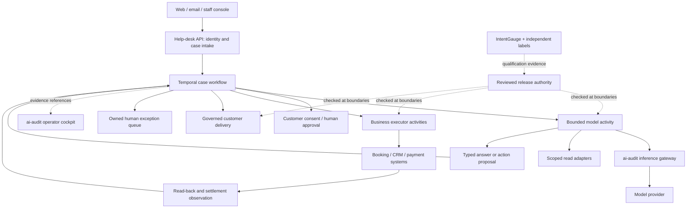

# Where the help desk belongs

Status: Proposed product architecture, 2026-11-04. This document recommends the deployment target; it does not claim a Temporal integration, production approval or completed migration.

The help desk should be an independently deployed casework application. Temporal should own durable execution. Short-lived model invocations should interpret one bounded work item, use scoped read tools and return an answer or typed proposal. ai-audit should supply inference controls, policy/grant evidence and operator inspection. IntentGauge should qualify candidate behavior outside the runtime path.

This follows the separation in [The Counting House](https://yegge.ai/essays/the-counting-house/): models propose, while a mechanical orchestrator owns business execution. The essay recommends an established durable engine rather than rebuilding multi-system workflows. Temporal is a suitable target for approvals, callbacks, retries and settlement that outlive a model invocation. It is not needed inside the inference proxy.

## Product and deployment ownership

| Component | Owns | Does not own |
|---|---|---|
| Help-desk application | Customer channels, authenticated case intake, intent-specific SOP, business data access, customer consent, human queues, case outcomes | Inference-provider secrets in model context or independent evaluation gold |
| Temporal application | Case/workflow progress, durable waits, approved action sequences, retry policy, timeouts, reconciliation scheduling | Business eligibility or authorization merely because a workflow exists |
| Model worker | Bounded interpretation, scoped reads, answer drafts and typed proposals | Backend write credentials, durable case ownership or choosing its own authority |
| Business executor workers | Current-state validation, exact-operation authorization, original payment routing, idempotent effects and read-back | Inferring consent or ownership from model assertions |
| ai-audit | Model-traffic protection, policy/qualification/grant evidence, runtime records, investigations and the shared operator cockpit | Booking/payment truth, the authoritative case workflow or a general saga runtime |
| IntentGauge | Independent evaluations, human/judge calibration, regression and outcome analysis | Production routing or automatic grant activation |

The existing Python help-desk application is the natural starting application because it already owns a domain loop and tools. Its current location under an EternalChat copy is a prototype location, not the deployment boundary to preserve. Give the casework application its own package/repository and release identity. EternalChat can be a staff-facing channel if useful; it should not be required to keep a refund alive. The JavaScript CityWheels example remains a compact integration/conformance fixture for ai-audit, rather than a second production help-desk product.

The current local casework stores and fake executor demonstrate evidence and action contracts. Keep useful conformance tests and synthetic failure scenarios. Do not grow those JSON stores and process locks into a production workflow engine. Generic qualification/authority/evidence interfaces can remain in ai-audit; domain workflows, channel delivery, booking rules and durable business state belong to the application.

## Runtime arrangement

Begin with a case workflow that invokes a small catalog of explicit business workflows, such as cancellation/refund. Do not create a universal agent planner. The application can keep a case read model in a database for search, assignments and channel views; workflow execution history is the authoritative record of orchestration progress. Booking and payment systems remain authoritative for their own business facts.

Model and external I/O calls belong in Activities. Workflow code coordinates durable steps and messages under Temporal's replay constraints. Human approval and backend callbacks arrive through an authenticated application API, which sends validated workflow messages. A message containing `approved: true` is insufficient: the application must bind the reviewer/customer identity, proposal digest, record version, amount, currency and expiry.

Deploy model workers and executor workers with separate service identities, secrets and network access. Task queues route work; naming two queues alone does not isolate credentials. The model service can access read adapters and the inference gateway, while executor services can access the appropriate write APIs. A successful model tool proposal never bypasses an executor authorization check.

For a cancellation, the durable flow is: authenticate scope → load current facts → draft a bounded proposal → recompute eligibility and amount → obtain required consent/review → recheck grant and current state → dispatch with a stable operation ID → read back → wait for settlement → deliver the observed result or create an owned exception. Recheck expiring authority immediately before each new privileged action. A pinned workflow release does not preserve a revoked grant.

Temporal does not make an external refund exactly once by itself. Activities may retry, so external effects still require idempotency and read-back. A crash after commit can leave an unknown result. Reconcile before repeating a write. A settled refund may need manual resolution; do not promise a fictitious rollback. Workflow versioning and worker deployment must preserve already-running cases.

## Autonomy is per intent and capability

| Tier | Model participation | Delivery and effects |
|---|---|---|
| Off | No model servicing this intent | Route to an owned human queue |
| Shadow | Draft beside actual human handling | No customer delivery or business effects |
| Assist | Suggest an answer or operation | Human review controls delivery; effects still require executor checks |
| Contain | Answer an approved narrow intent | Customer replies allowed within scope; business writes require a separate qualified capability |
| Transact | Propose narrowly permitted business operations | Only the executor writes, within the active grant, consent, limits and approval rules |

The first real pilot should be assist for authenticated cancellation quotes. A read-only opening-hours intent can later reach contain independently. Treat cancellation quotes, ordinary cancellations, goodwill exceptions and refunds as different intents/capabilities when their rules or risks differ. A refund should not inherit transaction permission merely because the FAQ model performs well.

Promotion needs representative independently reviewed evidence, measured human baseline/cost, an accountable owner, tested human fallback capacity, expiry and an explicit operational approval. Monitoring can propose demotion; reviewed restriction or a separately defined fail-closed control applies it. Recovery requires fresh evidence and review. Neither an eligible judge nor a passing report activates authority.

## Storage and privacy

Keep customer content in the application's governed store, with tenant access, retention and deletion rules. Pass opaque case/context references where possible, plus exact revision/digest identities. Temporal persists Workflow and Activity inputs/results, so indiscriminately placing full conversations in workflow arguments creates another retained content store. Use deliberately minimized payloads and payload encryption where required. Keep sensitive values out of searchable metadata and metric labels. Temporal history and ai-audit chains have different purposes and neither is a general compliance certification.

## Implementation order

1. Consolidate ADRs around the durable boundaries above. Keep implementation detail, experiments and migration steps in ordinary documentation.
2. Curate one ai-audit CityWheels integration example, with its workbench and conformance fixtures grouped together. Preserve the separate Python application as the application starting point.
3. Extract an application-facing contract for case references, current release/grant checks, proposals, approval messages and observed effects. Preserve current synthetic conformance tests.
4. Build one real Temporal cancellation/refund workflow against fake booking/payment adapters. Test process loss during approval waits, activity retries, duplicate callbacks, backend commit before acknowledgement, settlement delay, revocation while waiting and worker-version changes.
5. Run representative shadow/assist operation with governed data and real human fallback. Promote individual capabilities only after explicit operational approval; add real backend/channel credentials at executor boundaries.

The immediate objective is a usable vertical slice: an authenticated customer question becomes an owned case, gets a scoped answer/proposal, can wait through a restart for a reviewer, and ends in verified delivery/effect or an owned unresolved exception. A dashboard over synthetic green scores is not a substitute.

Sources checked 2026-11-04: [Counting House](https://yegge.ai/essays/the-counting-house/), [Temporal Workflows](https://docs.temporal.io/workflows), [Workflow definition and replay constraints](https://docs.temporal.io/workflow-definition), [Activities and idempotency](https://docs.temporal.io/activities), [Workers](https://docs.temporal.io/workers), [Python workflow messages](https://docs.temporal.io/develop/python/workflows/message-passing), [payload persistence and encryption](https://docs.temporal.io/production-deployment/data-encryption).
