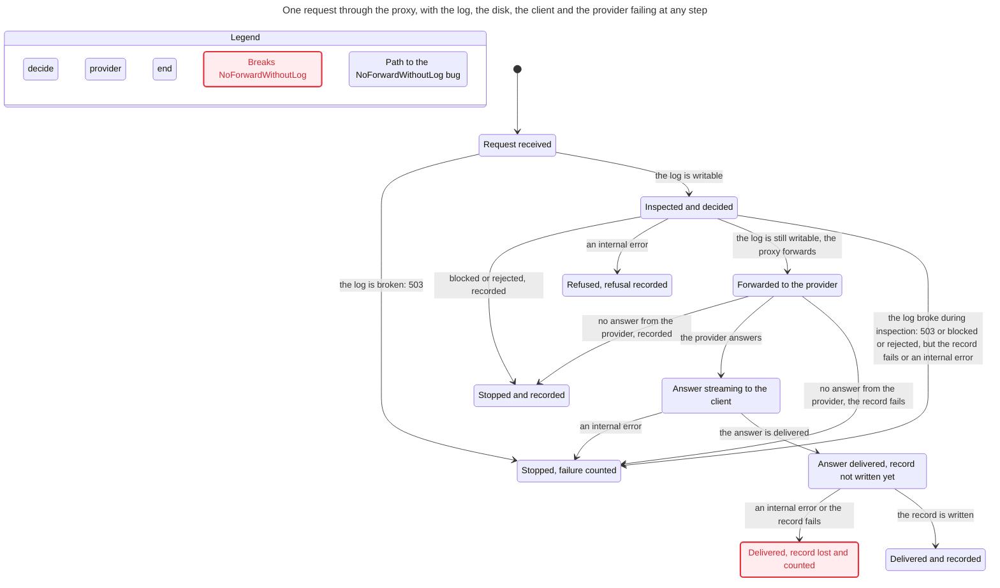
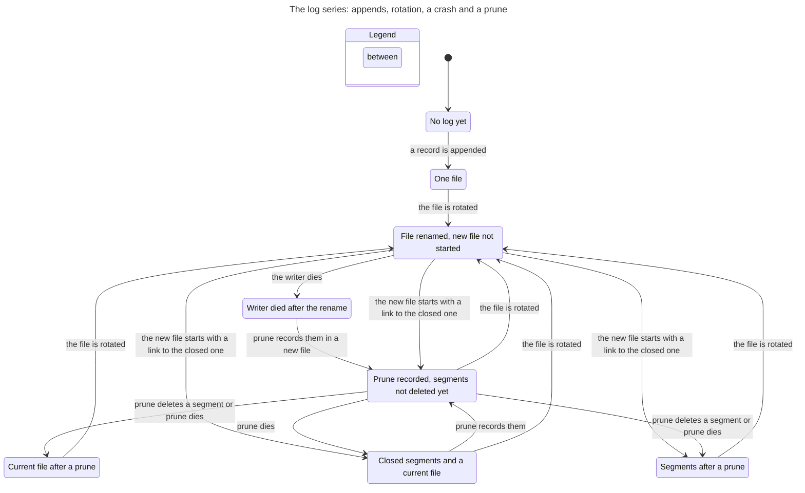
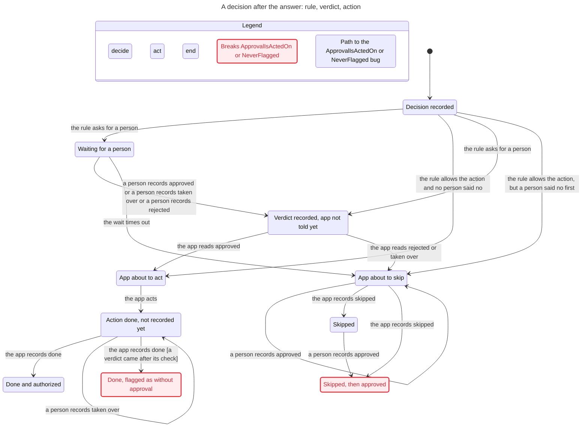

# Formal verification (TLA+ / TLC, Bend 2)

Run: `npm run verify:formal`. Procedure, coverage and sync commit: `.agents/skills/verify-audit-log/SKILL.md`.
Specs `spec/AuditChain.tla`, `spec/RequestLifecycle.tla`; configs `spec/*.cfg`; runner `spec/run.sh` (tla2tools v1.8.0, a pre-release that upstream rebuilds; v1.7.4 lacks `-noGenerateSpecTE`). CI runs `spec/run.sh` on every push to `main` and every pull request (ADR 0030).
Statecharts of the three models, drawn with `/statechart`: [Charts](#charts).

## Why TLA+
The questions were about the order of steps between processes and between a request and its environment (client close, timeout, log breaking). That is a model checker's job. Each model is paired with regression tests that run the real code, so a code change that breaks a property fails `verify:formal`.

## Findings (fixed)
1. Chain fork with two writer processes. Trace: A reads tail, B reads tail, A appends, B appends with the same prevHash. Reproduced: 2 processes x 300 appends, `verifyChain` = prevHash mismatch at line 83. Fixed by a lock file (commit 17ca7c9).
2. Torn last line: the response was delivered, nothing was logged, and `fail()` after `res.end()` crashed the process. Fixed by fail-closed checks and a write-after-end guard (commit 15b9985, ADR 0016).
3. Segment order followed the wall clock. If the clock stepped back between two rotations, the newer segment got an earlier name and sorted first, `startSegment` linked the next file to the wrong segment, and `ai-audit verify` reported `segment does not continue` from then on, although no record changed. Found at f6b1865, replayed with an injected clock. Fixed: a name comes after the newest closed segment and after the segment the current file links to (ADR 0056). `AuditChain_clockback.cfg` keeps the old naming and must fail.
4. An anchor of a pruned segment counted as swapped when it was not older than the first remaining segment: in the millisecond of the rotation, or before a clock step back. Found at f6b1865, replayed. Fixed: the anchor and the `prune` record name the segment by the hash of its first record (ADR 0056). `AuditChain_clockback_anchors.cfg` keeps the time rule and must fail.
5. `startSegment` opened the new file and then wrote its first record. A kill between the two steps left an empty current file, the next append started it without a link, and `verify` failed from then on. Found at f6b1865, replayed by truncating the new file. Fixed: the record is written to `<log>.segment` and renamed into place, and an append treats an empty current file like a missing one. `AuditChain_emptysegment.cfg` keeps the old order and must fail.
6. After a prune removed every closed segment and the clock stepped back, a rotation could reuse a pruned name, and a running `prune` deleted the new file by that name, together with its `prune` record. Found by `AuditChain.cfg` once the clock could step back in it. Fixed with finding 3: a name also comes after the segment the current file links to, so no name comes back.

## Results at the fix of findings 3 to 6
| Config | Expected | Result |
|---|---|---|
| AuditChain.cfg (2 writers x 2, rotation after 2 records, one crash, one prune, 2 anchors, one clock step back) | pass | pass, 1,109,143 distinct states |
| AuditChain_nolock.cfg | fail | ChainIntact violated |
| AuditChain_norestart.cfg (no `startSegment` for a missing current file) | fail | ChainIntact violated |
| AuditChain_unlinkfirst.cfg (prune deletes before it records) | fail | ChainIntact violated |
| AuditChain_clockback.cfg (names from the clock only) | fail | ChainIntact violated |
| AuditChain_clockback_anchors.cfg (pruned anchors by time) | fail | AnchorsConsistent violated |
| AuditChain_emptysegment.cfg (open, then write) | fail | ChainIntact violated |
| RequestLifecycle.cfg | pass | pass, 148 distinct states |
| RequestLifecycle_noguard.cfg | fail | NoCrash violated |
| RequestLifecycle_noprecheck.cfg | fail | NoForwardOnBadLog violated |
| RequestLifecycle_residual.cfg | fail | NoForwardWithoutLog violated (known window, ADR 0016) |
| RequestLifecycle_nocount.cfg (outer catch without `\|\| forwarded`) | fail | NoRefusalAfterForward violated |
| RequestLifecycle_norefusal.cfg (code before fc88731) | fail | NeverSilent violated |

Real-code mutations caught by `verify:formal`: append without `withLock` (multi-process test fails), outer catch without `res.writableEnded` (late-failure test fails), both `ensureWritable()` checks removed (torn-tail 503 test fails). Checked at f6b1865: no `startSegment` for a missing current file (`test/segments.test.ts` fails), no `|| forwarded` in the outer catch (`test/logsafety.test.ts` fails, the test added with this check), no refusal record for an internal error (`test/refusals.test.ts` fails). Prune that deletes before it records passes every test; only `AuditChain_unlinkfirst.cfg` catches it. The old segment naming, the time rule for pruned anchors, the open-then-write segment start and the reuse of a pruned name each fail a test in `test/segments.test.ts` (run on the code before the fix).

Not modelled: attachment cache vs inspection profile (reviewed: key includes `profile.id`, profile frozen per instance; no stale path).

## The decision loop (ADR 0055, ADR 0057)
`spec/DecisionLoop.tla` models one decision after the answer. The rule either allows its action or asks for a person. A person records a verdict at any time, in the console or with `approve`, and a decision takes one verdict. An application that follows the protocol checks for a verdict before an action the rule allows; otherwise it runs `ai-audit await`, acts on `approved`, skips on `rejected` or `overridden`, and records `skipped` when the wait times out. It records what it did with `ai-audit effect`. A done effect counts as authorized as `effectAuthorized` decides: the latest review before it is `approved`, or there is none and the rule allowed the action. 52 distinct states.

| Config | Expected | Result |
|---|---|---|
| DecisionLoop.cfg (one verdict, check first) | pass | WaitingAppNeverFlagged and NoActAgainstEarlierVerdict hold |
| DecisionLoop_latestwins.cfg (any number of verdicts, the latest counts) | fail | WaitingAppNeverFlagged violated |
| DecisionLoop_nocheck.cfg (the app acts on the rule without a check) | fail | NoActAgainstEarlierVerdict violated |
| DecisionLoop_residual.cfg | fail | NeverFlagged violated (known window, ADR 0057) |
| DecisionLoop_unacted.cfg | fail | ApprovalIsActedOn violated (known window, the console warns, ADR 0057) |

Chart: [Decision loop](#decision-loop-decisionlooptla-decision-loopcfg-52-model-states), 10 states and 14 arrows. Its two red states are the known windows.

Findings, both resolved by ADR 0057:
7. An application that followed the protocol could be flagged as acting without approval. A person recorded `taken over` before the app acted on the rule, or `rejected` after the app read `approved` and before it recorded done. After a take-over the action ran, although ADR 0055 says that the application does not run it. Now a decision takes one verdict, and the app checks before an action the rule allows. What stays: a verdict that lands between that check and the effect record (`DecisionLoop_residual.cfg`).
8. An approval could end with nothing done and nothing on the console's attention list: the wait timed out, and a person approved later. Now the app records `skipped` with code `timeout`, and the console lists each approved decision without a done action after `--overdue-minutes` (`DecisionLoop_unacted.cfg` keeps the path).

Fixed while building this model: `awaitVerdict` looked for a review only in the two newest files, so after two rotations it returned `timeout` for an approved decision (commit afd1757).

## Charts
Drawn with `/statechart` (pstack) from the TLA+ models. Each chart uses the config and the view module of the same name in this folder (`<name>.cfg`, `<name>.view.mjs`): the view gives the words on states and arrows, the config gives the bounds and the rules to mark. `/statechart` runs the TLC version that it pins (v1.7.4); with v1.8.0 its SANY reader stops with `Cannot read properties of undefined (reading 'tag')`. A red state breaks a rule; a blue border marks the shortest path to it.

### Request lifecycle (RequestLifecycle.tla, request-lifecycle.cfg: 148 model states)

### Log series (AuditChain.tla, audit-chain.cfg: one writer, five appends, one crash, one prune; 380 model states)

### Decision loop (DecisionLoop.tla, decision-loop.cfg: 52 model states)

## Proofs in Bend 2 (ADR 0029)
Run: `npm run verify:bend` (needs Bend 2.0.38 on PATH; `sh bend/install.sh` installs it into `~/.bend` and checks the archive's sha256, ADR 0030). CI runs it on every push to `main` and every pull request. Code `bend/context.bend` (token split, ADR 0017), `bend/arena.bend` (arena ages, first change and runs, ADR 0020), `bend/usage.bend` (turn tokens, the provider-cache-drop signal and report totals, ADR 0012 and ADR 0020) `bend/spans.bend` (the merge of overlapping finding spans before redaction, ADR 0007) `bend/parts.bend` (which spans are removed from the joined text when a message has several text parts, ADR 0007) `bend/mask.bend` (which bytes of each text part the provider gets after redaction, ADR 0007), `bend/decide.bend` (the decision to forward or block a request, ADR 0009), `bend/policies.bend` (the policy versions of each use case in `report` and `ai-audit policies`, ADR 0027), `bend/budget.bend` (the admission and the charge of a key's token budget, ADR 0044) and `bend/verdict.bend` (whether an effect that an application recorded followed the rule or a verdict, ADR 0055 and ADR 0057), laws `bend/LAWS.bend`, proofs `bend/PROOF.bend`, runner `bend/run.sh`. The committed `src/bend/*.mjs` must match the code; `bash bend/run.sh --write` regenerates them.

| Check | Expected | Result |
|---|---|---|
| Laws in LAWS.bend: the split sums to the provider total; each part is its floor, or one more only when the share is not whole; an empty segment gets 0; leftover tokens go to the largest remainders, ties to the earlier segment | pass | ALL PROOFS CHECK |
| Laws in LAWS.bend: the first change is where the hashes first differ inside the previous request, and its offset is the bytes before it; ages keep the unchanged prefix, the rest is the current turn; the runs keep every byte with its kind and age; the runs merge neighbours of one kind and age, and the first changed block starts a new run; the arena reads hashes only position by position | pass | ALL PROOFS CHECK |
| Laws in LAWS.bend: unknown input stays unknown, never 0; with a known input, an Anthropic prompt is the input plus the cache read and the cache write, and an OpenAI prompt is the input, whose uncached part is the input minus the cache read and never below 0; a provider cache drop is reported only when the previous prompt and the current cache read are known, the expected prefix is at least 1,024 tokens and the cache read is below half of it; report totals add known counts and count unknown ones apart; the fast totals loop gives the same totals | pass | ALL PROOFS CHECK |
| Laws in LAWS.bend: when the finding spans are sorted by start, every byte inside a finding is inside a merged span; every byte inside a merged span is inside a finding; merged spans do not overlap; no span merges to nothing and one span stays as it is | pass | ALL PROOFS CHECK |
| Laws in LAWS.bend: the result keeps every span in order; a span whose match crosses a part boundary is taken; no untaken match touches a taken span; nothing else is taken (the result is below every set with those two properties); the fast version gives the same marks | pass | ALL PROOFS CHECK |
| Laws in LAWS.bend: for each text part, the provider gets every byte outside the findings, in order, and one marker at the first byte of each finding, and nothing else | pass | ALL PROOFS CHECK |
| Laws in LAWS.bend: with no finding the original is forwarded; advisory mode forwards the original; no-go mode blocks any finding; redact mode forwards a masked copy only when every finding can be masked, and blocks otherwise | pass | ALL PROOFS CHECK |
| Laws in LAWS.bend: each use case is listed once, in order of first use; each program of a use case is listed once, in order of first use within it; each version's first and last decision and its decision count are those of the use case's decisions with that program; the current version is the program of the use case's latest decision | pass | ALL PROOFS CHECK |
| Laws in LAWS.bend: a blocked budget admits nothing; a reservation is admitted exactly when the used tokens plus the request fit the limit, for input and for output; a settle charges the known usage (for Anthropic, input plus cache read and cache write) or else the reservation, and it is an overrun exactly when a charge is above its reservation; an admitted reservation whose settle is not an overrun keeps the used tokens plus the charge within the limit | pass | ALL PROOFS CHECK |
| Laws in LAWS.bend: an effect that is not done needs no verdict; a done effect is authorized when the rule simulated its action and the latest review before it did not reject or override it, or when that review approved it; whatever reviews came before, the review recorded last decides | pass | ALL PROOFS CHECK |
| `--verdict` (Lean-checked kernel) | pass | skipped, Lean v4.34.0 not installed |

Each mutant must fail `PROOF.bend`, and its counterexample in `bend/stops/` must check against the mutant and fail against the real code. A failing proof alone can come from the proof's wording; the counterexample shows that a named law rejects the mutant's output.

| Mutant | Change | Counterexample breaks | At |
|---|---|---|---|
| leftover | one leftover token too many | `split_sums_to_provider` | p=1, sizes [1, 1] |
| double-bump | a raised share gets two tokens | `split_rounds_each_share` | p=1, sizes [1, 1] |
| empty-segment | an empty segment competes for a leftover token | `split_gives_empty_none`, `split_rounds_each_share` | p=1, sizes [0, 1, 1] |
| tie-to-later | a tie goes to the later segment | `split_leftover_to_largest_remainders` | p=1, sizes [1, 1] |
| smallest-first | the smallest remainder gets the leftover token | `split_leftover_to_largest_remainders` | p=1, sizes [1, 2] |
| first-shifted | a rewrite is reported one block late | `arena_first_change_is_the_first_difference` | previous [0], blocks [1] |
| offset-skips | the offset leaves out the unchanged blocks | `arena_first_change_is_the_first_difference` | previous [0, 0], blocks [0 (5 bytes), 1] |
| ages-reset | an unchanged block gets the current turn | `arena_ages_keep_the_unchanged_prefix` | previous [0 age 1], blocks [0], turn 2 |
| bytes-lost | merging two blocks keeps only the first one's bytes | `arena_runs_keep_every_byte_with_its_kind_and_age` | blocks [3 bytes, 4 bytes] of one kind and age |
| kind-lost | every run gets kind 0 | `arena_runs_keep_every_byte_with_its_kind_and_age` | one user block of 1 byte |
| age-lost | every run gets age 0 | `arena_runs_keep_every_byte_with_its_kind_and_age` | one user block of 1 byte, turn 1 |
| never-merge | every block gets its own run | `arena_runs_merge_neighbours_of_one_kind_and_age` | blocks [3 bytes, 4 bytes] of one kind and age |
| merge-across-change | the first changed block joins the run before it | `arena_runs_merge_neighbours_of_one_kind_and_age` | previous [0 age 2, 5 age 2], blocks [0, 1], turn 2 |
| hash-ordered | two hashes are compared by order, not for equality | `arena_reads_hashes_only_position_by_position` | previous [5 age 1], blocks [3], turn 2 |
| unknown-as-zero | unknown input becomes 0 tokens | `usage_unknown_input_stays_unknown` | OpenAI, no counts |
| write-subtracted | an Anthropic prompt subtracts the cache write | `usage_known_input_splits_the_prompt` | Anthropic, input 0, cache write 1 |
| cached-added | an OpenAI input adds the cache read | `usage_known_input_splits_the_prompt` | OpenAI, input 0, cache read 1 |
| threshold-off | the 1,024-token minimum becomes 1,023 | `usage_cache_drop_only_from_evidence` | previous prompt 1,023, cache read 0 |
| half-wrong | "below half of the prefix" becomes "below the prefix" | `usage_cache_drop_only_from_evidence` | previous prompt 2,000, cache read 1,500 |
| unknown-not-counted | a billed call with unknown input is not counted as unknown | `usage_totals_count_unknown_apart` | one billed call without input |
| fast-output-as-input | the fast totals put an unknown input in the unknown-output count | `usage_fast_totals_match_the_spec` | one billed call with output 1 and no input |
| lost-extension | an absorbed span does not extend its group, so the tail of a secret survives | `spans_mask_every_finding_byte` | spans [0, 3) and [2, 6), byte 4 |
| over-mask | a new group masks one byte past its span | `spans_mask_only_finding_bytes` | span [0, 3), byte 3 |
| overlap-opens | a new group opens while the spans still overlap | `spans_groups_are_apart` | spans [0, 4) and [2, 6) |
| phantom-group | the merge starts with an empty group | `spans_merge_of_no_span_is_empty` | no span |
| opened-as-grown | a new group is marked as extended | `spans_merge_of_one_span_keeps_it` | span [0, 1) |
| marks-reversed | the taken marks come back in reverse order | `parts_keep_every_span_in_order` | no boundary, spans [0, 1) and [2, 3) |
| crossing-missed | the walk ignores the boundaries after a span's start | `parts_take_every_span_whose_match_crosses_a_part` | boundary 5, span [3, 8) |
| touch-ignored | the backward pass never takes a span | `parts_untaken_matches_touch_no_taken_span` | boundary 6, spans [0, 2) with match [0, 5) and [4, 8) |
| over-take | every span is taken | `parts_take_no_span_that_crossings_do_not_force` | no boundary, span [0, 2) |
| fast-skips-closure | the fast version never runs the closure | `parts_fast_version_gives_the_same_marks` | boundary 6, spans [0, 2) with match [0, 5) and [4, 8) |
| fast-backward-blind | the fast backward pass never takes a span | `parts_fast_version_gives_the_same_marks` | boundary 6, spans [0, 2) with match [0, 5) and [4, 8) |
| keep-into-finding | the byte after a finding's start is kept | `mask_keeps_each_byte_outside_findings_and_marks_each_finding_once` | text of 5 bytes, finding [1, 3) |
| marker-dropped | a finding that ends inside its part gets no marker | `mask_keeps_each_byte_outside_findings_and_marks_each_finding_once` | text of 5 bytes, finding [1, 3) |
| remark-continued | a finding that continues into the next part gets a second marker there | `mask_keeps_each_byte_outside_findings_and_marks_each_finding_once` | parts ending at 2 and 5, finding [1, 4) |
| index-not-advanced | the second finding gets the first finding's marker | `mask_keeps_each_byte_outside_findings_and_marks_each_finding_once` | text of 6 bytes, findings [1, 2) and [3, 4) |
| empty-blocks | a request with no finding is blocked | `decide_forwards_the_original_when_nothing_is_found` | redact mode, no finding |
| advisory-blocks | advisory mode blocks a finding | `decide_forwards_the_original_in_advisory_mode` | one finding |
| no-go-forwards | no-go mode forwards a masked copy | `decide_blocks_every_finding_in_no_go_mode` | one finding |
| unmaskable-masked | a finding that cannot be masked is treated as maskable | `decide_masks_in_redact_mode_only_when_every_finding_can_be_masked` | one finding in a JSON key |
| count-not-added | a program used again does not add to its decision count | `policies_count_each_version_from_its_first_to_its_last_decision` | two decisions of one program |
| last-not-moved | a program used again keeps its first decision as the last one | `policies_count_each_version_from_its_first_to_its_last_decision` | two decisions of one program |
| first-moved | a program used again moves its first decision | `policies_count_each_version_from_its_first_to_its_last_decision` | two decisions of one program |
| rollback-new-version | a program used again after another one becomes a new version | `policies_list_each_program_of_a_use_case_once_in_order_of_first_use` | programs a, b, a in one use case |
| group-listed-twice | a use case is listed again at its second decision | `policies_list_each_use_case_once_in_order_of_first_use` | two decisions of one use case |
| group-dropped | a new use case is not listed | `policies_list_each_use_case_once_in_order_of_first_use` | one decision |
| current-is-group-key | the current version is read from the use case's key | `policies_mark_the_program_of_the_latest_decision_current` | one decision |
| blocked-admits | a blocked budget admits a reservation | `budget_blocked_admits_nothing` | blocked, all counts 0 |
| at-limit-refused | a request that reaches the limit exactly is refused | `budget_admits_exactly_what_fits` | used 0, request 1, limit 1 |
| used-over-limit | the check that the used tokens are within the limit is dropped, so `limit - used` stops at 0 and a request of 0 passes | `budget_admits_exactly_what_fits` | used 2, request 0, limit 1 |
| output-not-checked | only the input side is checked | `budget_admits_exactly_what_fits` | output request 1, output limit 0 |
| unknown-charged-zero | an unknown count charges 0 instead of the reservation | `budget_charges_known_usage_or_the_reservation` | reservation 5, no usage |
| cache-not-charged | an Anthropic charge leaves out the cache read | `budget_charges_known_usage_or_the_reservation` | input 1, cache read 2 |
| overrun-at-reservation | a charge equal to the reservation counts as an overrun | `budget_charges_known_usage_or_the_reservation` | reservation 1, input 1 |
| overrun-output-ignored | an output above its reservation is not an overrun | `budget_admitted_and_not_overrun_stays_within_the_limit` | all 0, output 1 |
| first-review-wins | the first review decides instead of the latest | `verdict_the_review_recorded_last_decides` | approved, then rejected, rule did not simulate |
| approval-ignored | an approval counts only when the rule simulated the action | `verdict_a_done_effect_follows_the_latest_review` | approved, rule did not simulate |
| rejection-follows-rule | a rejection counts only when the rule did not simulate the action | `verdict_a_done_effect_follows_the_latest_review` | rejected, rule simulated |
| override-authorizes | an override authorizes the rule's action | `verdict_a_done_effect_follows_the_latest_review` | overridden, rule did not simulate |
| not-done-needs-rule | an effect that is not done needs the rule's simulation | `verdict_an_effect_not_done_needs_no_verdict` | skipped, rule did not simulate |
| no-review-authorizes | a done effect without a review is always authorized | `verdict_a_done_effect_follows_the_latest_review` | no review, rule did not simulate |

The empty-segment counterexample fails against the earlier quota law, which allowed one more token for a whole share. The tie-to-later and smallest-first mutants satisfy the first three laws; only the fourth rejects them. An earlier `zero-remainder` mutant added 1 to every remainder; it changed 0 of 28,125 outputs and has no counterexample, so it was removed.

The four laws together fix the split: the sum fixes how many segments get one more token, the quota law limits them to shares that are not whole, and the fourth law makes them the largest remainders. `test/laws.test.ts` still compares the generated JavaScript with an exact-integer reference, because a proof covers the Bend code, not the JS backend.

The arena laws fix the first change and the ages (a TypeScript translation of the first-change law accepts exactly one answer on 10,360 small inputs) and the kind and age of every byte in the runs. A first version of the runs law counted bytes only and accepted runs with a wrong kind or age (the kind-lost mutant passed it on 5,004 of 5,004 inputs). The per-byte law cannot see where runs split or a run of 0 bytes (a message with content `""`): the never-merge and merge-across-change mutants gave wrong runs on 4,515 and 60 of 20,004 inputs and passed it. `arena_runs_merge_neighbours_of_one_kind_and_age` closes that: `ExpectedRuns` walks the blocks with one open run, adds a block of the same kind and age unless it is the first changed block, and otherwise closes the run; it gives the original runs on 20,004 of 20,004 inputs. With it the laws fix the whole arena output. `test/arena.test.ts` still checks the generated JavaScript with 504 goldens captured from the TypeScript arena (`test/fixtures/arena-goldens.json`, written once by `test/fixtures/capture-arena-goldens.ts`) and with the TypeScript arena kept as a reference in `test/arenaReference.ts`. In the generated JavaScript, a call that is not in tail position overflows the stack below 10,000 list elements, so every loop in `arena.bend` is a tail call; the reference test includes a request of 200,000 blocks.

The usage laws are mostly the ADR 0012 and ADR 0020 rules written out; `CacheDropped` states the rule in the ADR's order, so its proof is not a computation of both sides. Before the port, `ai-audit report`, `stats` and the session view counted any finite number as a known token count: a record with input `-400` lowered the total and was reported complete. They now use the log writer's rule (`tokenCount`). At the Bend boundary a count above 2^48-1 (281 trillion tokens, which no provider reports) is unknown; the TypeScript counted it. `test/usageCore.test.ts` replays 300 goldens captured from the repaired TypeScript (`test/fixtures/usage-goldens.json`), compares with the TypeScript kept in `test/usageReference.ts` on 20,000 generated inputs and a log of 200,000 calls, and pins the 2^48-1 limit. `usage_known_input_splits_the_prompt` fixes every field of a turn with a known input; before it, a mutation run (porting-to-bend2 `law-mutation.sh`) found that a prompt that subtracts the cache write and an input that adds the cache read passed every usage law; only the tests of the generated JavaScript (the goldens, the reference comparison and a `turnTokens` test) rejected them.

The span laws cover the step between the regex rules and `redactText`: `mergeSpans` in `src/scan.ts` sorts the spans with JavaScript's stable sort (start ascending, end descending) and Bend merges them. Only the first law needs the sorted order, and it states it as a premise; the other two hold for any order. The regex rules and the text assembly stay in TypeScript, and no string enters Bend. For the first two laws, each counterexample in `bend/stops/` also proves the law's premises for the bad case, so it refutes a whole instance of the law. `test/spans.test.ts` replays 404 goldens captured from the TypeScript merge (`test/fixtures/span-goldens.json`), compares with the TypeScript kept in `test/spanReference.ts` on 20,000 generated inputs and on 50,000 spans of one string, and the fuzz harnesses for masking still pass. The merge costs about 0.05 µs more per string without findings, under 1% of `inspect()`.

The cross-part laws cover `takenAcrossParts` in `src/scan.ts`. When an array has two or more text parts, the scanner joins them and scans the joined text; a span whose match crosses a part boundary is removed from the parts directly, and so is any span whose match touches a removed span (its regex context is gone after the removal, so a scan of one part could miss it). The other spans are left to the scan of each part. The four laws fix the result: the spans that cross are taken, the taken set is closed under "touches", and it is the smallest such set. The premises are that the boundaries are sorted and that the spans are apart and each inside its match, which `mergeSpans` and the regex groups give. Bend finds the crossing spans in one merge walk over the boundaries, with no search; the closure runs a backward and a forward pass until a round takes nothing, and the count of untaken spans bounds the rounds. In the worst case (a chain where each span touches only the one taken before it) this needs one round per span, as the TypeScript loop did: 2,000 such spans take about 60 ms in both. `test/crossParts.test.ts` replays 405 goldens captured from the TypeScript closure (`test/fixtures/cross-goldens.json`) and compares with the TypeScript kept in `test/crossReference.ts` on 20,000 generated inputs, 100,000 spans and a 300-span chain.

The redaction law covers `redactText` and `maskParts` in `src/scan.ts`, the last step before the request leaves the proxy. Bend returns a plan for each text part: keep the bytes from one position to another, or write the marker of finding i. TypeScript only slices the text and writes `[REDACTED:rule]` for each marker. The law states the result position by position: a byte inside a finding is dropped, the first byte of each finding becomes that finding's marker, and every other byte stays, in order, in the part that holds it. A finding that continues into the next part gets no second marker. The premises are that the part ends are sorted and that the findings are sorted, apart and not empty, which `mergeSpans` and the regex groups give. With `spans_mask_every_finding_byte`, this proves the chain from a regex match to the bytes the provider gets: every byte inside a finding is inside a merged span, and no byte inside a merged span reaches the provider. `test/mask.test.ts` replays 408 goldens captured from the TypeScript (`test/fixtures/mask-goldens.json`) and compares with the TypeScript kept in `test/maskReference.ts` on 20,000 generated inputs, on 50,000 findings in one text and on 20,000 parts.

The decision laws cover `decide` in `src/scan.ts`, the one decision per request of ADR 0009. TypeScript gives Bend the mode and, for each finding, whether it can be masked (a finding in a JSON key or one marked unredactable cannot), and turns the answer into the action, the status and the code. The four laws fix the answer for every mode and every list of findings. An unknown mode is treated as redact, as before; the CLI accepts only the three modes. `test/decide.test.ts` replays 120 goldens (every mode and every list of up to three findings of three kinds, `test/fixtures/decide-goldens.json`) and compares with the TypeScript kept in `test/decideReference.ts` on 2,000 generated lists of up to 2,000 findings.

The policy laws cover `policyHistories` in `src/policies.ts`, the versions of ADR 0027. TypeScript keeps the record checks and the filters, numbers each use case and each program at first sight, and gives Bend one `Use` per counted decision with both numbers as bit lists; it maps Bend's answer back to the hashes, names and timestamps. Bend keeps the use cases and the programs of each use case in binary tries keyed by those bits, so a lookup takes one step per bit, and the walk over the decisions is a tail call. A first version with plain lists was proved easier but overflowed the stack at 10,000 use cases or 10,000 versions of one use case, and grew with the square of their number; the TypeScript handled both. The laws state the result with plain lists in the order of the log: `FirstUseCases` and `FirstPrograms` skip what they have seen, `ExpectedStat` gives each decision its index, and `LatestProgram` takes the last match. Together they fix the whole output. The proof runs on `build`, the same steps from the newest decision back, and a lemma shows that the tail-recursive walk gives the same state. `test/policyHistories.test.ts` replays 208 goldens captured from the TypeScript (`test/fixtures/policies-goldens.json`, written once by `test/fixtures/capture-policies-goldens.ts`), compares with the TypeScript kept in `test/policiesReference.ts` on 1,000 generated logs of up to 2,000 decisions and on a log of 100,000 decisions, and checks 50,000 use cases of one decision each and 50,000 versions of one use case.

The budget laws cover `admission` and `charge` in `src/budget.ts`, the token budgets of ADR 0044. TypeScript keeps the files, the lock, the map of pending reservations and the sums over it, and gives Bend the used tokens (spent plus pending), the request and the limits; a value above 2^48-1 makes the budget unavailable (503) unless it is blocked, a usage count above 2^48-1 is unknown, and a limit above 2^48-1 is a config error. Bend checks `used <= limit` and `request <= limit - used`, so no sum can pass 2^48-1; the law states the plain rule with the sum, and `fits_eq` proves that both say the same. The `used <= limit` check matters because `Nat.sub` stops at 0: the used-over-limit mutant drops it and admits a request of 0 to a budget already over its limit. The fourth law joins both functions: if a reservation was admitted and its settle is not an overrun, the used tokens plus the charge stay within the limit, so only an overrun can take a budget past it, and an overrun blocks it. `test/budgetCore.test.ts` replays 613 goldens captured from the TypeScript (`test/fixtures/budget-goldens.json`, written once by `test/fixtures/capture-budget-goldens.ts`); 233 of them have a number above 2^48-1 and follow the rule above. It also compares with the TypeScript kept in `test/budgetReference.ts` on 20,000 generated inputs, and pins the rule at 2^48-1.

The verdict laws cover `effectAuthorized` in `src/verdict.ts`, the check of ADR 0055 that the console and `ai-audit effect` show. TypeScript finds the effect, its decision and the reviews of that decision before it, in log order, and reads whether the rule simulated the effect's action; a verdict other than approved, rejected or overridden counts as rejected, as before. Bend walks the reviews with a tail call and keeps the last one. `ExpectedAuthorized` is the ADR's sentence: authorized when the rule simulated the action and the latest review did not reject or override it, or when the latest review approved it. `LastOf` finds the last review without an accumulator, and a lemma shows that the walk gives the same review for any start value. The third law holds for any reviews before the last one, so an earlier approval or rejection never decides; ADR 0057 allows one verdict per decision, but logs from before it can hold more. `test/verdictCore.test.ts` replays 200 logs of goldens captured from the TypeScript (`test/fixtures/verdict-goldens.json`, written once by `test/fixtures/capture-verdict-goldens.ts`, 1,346 effects), compares with the TypeScript kept in `test/verdictReference.ts` on 2,000 generated logs, and checks an effect after 100,000 reviews.
### Speed
In the proxy, Bend runs as generated JavaScript, which is sequential: Bend's parallel runtime needs its native C, Metal or CUDA build. The generated loops are plain `for` loops, so most of the cost is at the boundary: each element becomes a record, an optional count becomes a `Some` or `None` object, and each list position becomes a cell; inside Bend, pure code makes a new record per step where TypeScript updates numbers in place, and each `Nat` addition checks the 2^48-1 limit. Strings are the worst case: a Bend scan of a string costs about 50 ms per MiB, 25 times a TypeScript loop, because each step slices the string. So scanning, masking and extraction stay in TypeScript (ADR 0029).

Where a faster form is worth it, the fast code is written next to the proved code and a law states that both give the same result, so the other laws carry over without new proofs: `totals.fast` keeps the five sums in parameters instead of a new record per call, and `taken.fast` skips the closure when no span crosses and keeps the pass state in parameters. Two closed laws (no span, one span) let `mergeSpans` return without calling Bend for strings with fewer than two findings, which is almost every string. `arena_reads_hashes_only_position_by_position` lets `arenaOf` number hashes by position (equal to the previous hash at the same position, or not) instead of through a `Map`. `npm run bench:bend` runs each case in its own process (Apple M-series, Node 24, medians of 15):

| Case | Bend | TypeScript reference |
|---|---|---|
| arena, 200 blocks (was 24 µs) | 16 µs | 7 µs |
| span merge, string without findings (was 0.05 µs) | 0.004 µs | 0.03 µs |
| span merge, 50,000 spans | 13 ms | 8 ms |
| cross-part, 2 parts and 2 spans | 0.16 µs | 0.03 µs |
| cross-part, 100,000 spans | 14 ms | 8 ms |
| redaction, 1 KB text with 3 findings (only texts with findings) | 0.5 µs | 0.2 µs |
| decide, 3 findings (once per request) | 0.03 µs | 0.007 µs |
| usage totals, 200,000 calls (was 18 ms) | 6 ms | 5 ms |
| policy histories, 100,000 decisions (offline `report` and `policies`) | 44 ms | 36 ms |

For a 200-message request, all Bend calls together take about 20 µs, against about 9 ms for `inspect()`.
